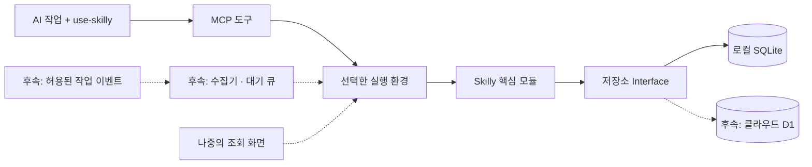

# Skilly

**AI가 작업하면서 기록하고, 다음 작업에서 필요한 근거와 스킬을 찾아 쓰는 프로젝트 기억 도구.**

사용자는 평소처럼 AI에게 작업을 요청합니다. Skilly가 프로젝트별 작업 기록을 저장하고 다음 작업에서 필요한 내용을 찾아줍니다. 현재는 로컬 SQLite 버전이며, 클라우드·팀 공유·프로젝트 이전·스킬 라이브러리는 후속 구현입니다.

**생각하고 개발하는 AI는 기존 Codex·Cursor입니다.** Skilly는 전달받은 내용을 저장하고, 인덱스로 찾고, 코드로 정한 규칙에 따라 기록 상태를 관리합니다. 자체 AI 모델·추론 서버·LLM API 호출을 넣지 않습니다.

> 현재 단계: **로컬 MVP 0.1.0**. CLI와 MCP로 등록·기록·검색·정정 이력·작업 마감을 실행할 수 있습니다. 모든 기록은 AI가 제출한 미확인 설명입니다. 실행 결과를 관측하는 수집기와 자동 훅, 실제 클라이언트 연결은 아직 없습니다.

## 바로 실행

Node.js 24 이상이 필요합니다. 현재 검증 환경은 Node.js 25.2.1입니다.

```sh
npm ci --ignore-scripts
npm test
npm run demo
```

데모는 임시 DB에서 신규 기록 → 정정 → 마감 → 다시 연결해 검색하는 흐름을 실행하고 임시 자료를 정리합니다. 실제 프로젝트 파일이나 사용자 DB를 읽지 않습니다.

MCP 실행 명령은 `node dist/runtime/local/main.js serve`입니다. 기본 DB는 `~/.skilly/memory.sqlite`이며 `--db`로 절대 경로를 지정할 수 있습니다. 연결 설정과 도구 입력은 [개발·사용 안내](docs/development.md)를 참고하세요.

## 먼저 볼 문서

| 알고 싶은 것 | 문서 |
|---|---|
| 지금 실행할 수 있는 기능과 도구 입력은 무엇인가 | [개발·사용 안내](docs/development.md) |
| 한 작업에서 누가 무엇을 호출하는가 | [한 사이클 따라가기](docs/workflow.md) |
| 모듈·폴더·DB 연결을 어떻게 나누는가 | [아키텍처](docs/architecture.md) |
| 다른 개발 작업을 방해하지 않게 어떻게 제한하는가 | [저자원 실행 기준](docs/architecture.md#7-빠르고-가볍게-만드는-기준) |
| 전체 기능·검색·최신성·이전 규칙은 무엇인가 | [제품 계획](docs/product-plan.md) |
| 기록·현재 지식·정본의 차이는 무엇인가 | [용어 사전](CONTEXT.md) |

## 기본 구성



한 프로젝트의 정본은 한 곳입니다. 현재는 로컬 DB에 확정된 기록만 저장 완료로 응답합니다. 클라우드용 전송 대기 큐는 후속 구현입니다.

## 기술과 구조

- **TypeScript**로 핵심 모듈을 작성합니다.
- 로컬 실행은 **Node.js + 내장 SQLite**, 연결은 **MCP SDK**, 입력 검증은 **Zod**를 사용합니다.
- **Hono**와 **Cloudflare Workers + D1**은 클라우드 전달 계층을 구현할 때 추가합니다.
- 기능별 모듈과 **Ports and Adapters**를 조합합니다. 핵심 규칙은 프레임워크·DB 드라이버에 의존하지 않습니다.
- 초기에는 화면이 없습니다. 나중에 화면이 추가돼도 같은 핵심 모듈을 사용합니다.
- 음성은 로컬 변환기의 결과를 받는 계약만 준비합니다. 변환 엔진은 후속 선택 기능입니다.
- 기본 실행은 AI 세션에 연결된 MCP 프로그램입니다. 요청·허용된 이벤트가 있을 때 처리하고, 프로젝트마다 상주 프로그램이나 전체 폴더 감시기를 만들지 않습니다.
- 요약·기능 분류·검색 후보의 의미 해석은 기존 작업 AI가 맡습니다. Skilly의 대기 중 동작과 응답·큐 크기는 [실행 기준](docs/architecture.md#7-빠르고-가볍게-만드는-기준)으로 제한합니다.

Cloudflare는 첫 연결 대상이며 아직 계정 연결·리소스 생성·배포를 수행하지 않았습니다. 무료 요금제 범위에서 시작하고, 비용이 드는 기능을 자동으로 활성화하지 않습니다.

## 폴더 안내

```text
Skilly/
├─ README.md
├─ CONTEXT.md
├─ docs/                 제품 계획 · 아키텍처 · 작업 흐름
├─ src/
│  ├─ core/              기록·검색·판정·이전의 공통 규칙
│  ├─ adapters/          SQLite·D1·파일·원격 연결 구현
│  ├─ transport/         HTTP·MCP·CLI 입력과 응답
│  └─ runtime/           로컬·클라우드별 모듈 조립
├─ integrations/
│  ├─ skills/            배포할 연동 스킬
│  └─ collectors/        실행 환경별 이벤트 수집
├─ migrations/           DB 구조 변경
└─ tests/
   └─ contracts/         저장소별 동일 동작 검증
```

현재 핵심 규칙은 `src/core/memory`, SQLite 연결은 `src/adapters/storage/sqlite`에 있습니다. `transport`의 도구 계약을 CLI와 MCP가 함께 사용합니다. 스킬 배포 원본은 `integrations/skills/use-skilly/SKILL.md`에 있으며 실제 클라이언트에 설치하지는 않았습니다. 전체 목표 구조는 [아키텍처](docs/architecture.md)에 있습니다.

## 코드와 사용자 데이터

이 저장소는 소스·설계·스키마·스킬 배포 파일을 관리합니다. 실제 DB, 녹음, 첨부, 전송 대기 큐와 내보내기 묶음은 별도의 사용자 데이터 폴더에 둡니다. 개발용 데이터도 버전 관리에서 제외합니다.

첫 실행 흐름은 “작업 AI의 도구 호출 → 기록 저장 → 다음 작업에서 재조회”입니다. 정상 자동 호출과 검증된 실행 근거 수집은 호스트별 연동을 추가한 뒤 확인합니다.
