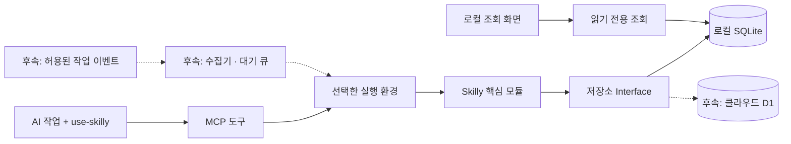

# Skilly

**AI가 작업하면서 기록하고, 다음 작업에서 필요한 근거와 스킬을 찾아 쓰는 프로젝트 기억 도구.**

사용자는 평소처럼 AI에게 작업을 요청합니다. Skilly가 프로젝트별 작업 기록을 저장하고 다음 작업에서 필요한 내용을 찾아줍니다. 현재는 로컬 SQLite 버전이며, 클라우드·팀 공유·정본 전환을 포함한 프로젝트 이전은 후속 구현입니다. 로컬 DB 백업·복원과 프로젝트별 사본 내보내기·가져오기는 [백업·이동 안내](docs/local-transfer.md)를 참고하세요.

**생각하고 개발하는 AI는 기존 Codex·Cursor입니다.** Skilly는 전달받은 내용을 저장하고, 인덱스로 찾고, 코드로 정한 규칙에 따라 기록 상태를 관리합니다. 자체 AI 모델·추론 서버·LLM API 호출을 넣지 않습니다.

> 현재 단계: **로컬 MVP 0.1.0 + Codex 연동**. CLI와 MCP로 등록·기록·검색·정정 이력·작업 마감을 실행하고, 프로젝트 식별·`use-skilly` 설치로 세션 간 기록을 연결합니다. 모든 기록은 AI가 제출한 미확인 설명입니다. 실행 결과 자동 수집기와 훅은 없습니다. 설정 생성·실제 연결·AI 자동 수행은 [Codex 연동 안내](docs/codex-integration.md)에서 구분합니다.

## 바로 실행

Node.js 24 이상이 필요합니다. 현재 검증 환경은 Node.js 25.2.1입니다.

```sh
npm ci --ignore-scripts
npm test
npm run demo
```

데모는 임시 DB에서 신규 기록 → 정정 → 마감 → 다시 연결해 검색하는 흐름을 실행하고 임시 자료를 정리합니다. 실제 프로젝트 파일이나 사용자 DB를 읽지 않습니다.

MCP 실행 명령은 `node dist/runtime/local/main.js serve`입니다. 기본 DB는 `~/.skilly/memory.sqlite`이며 `--db`로 절대 경로를 지정할 수 있습니다. 연결 설정과 도구 입력은 [개발·사용 안내](docs/development.md)를 참고하세요.

## 기록을 화면으로 보기

```sh
npm run view -- --db /Users/yeop/project/Skilly/.skilly/memory.sqlite
```

실제 사용 중인 DB의 절대 경로를 지정하고 터미널에 나온 전체 주소를 여세요.
프로젝트·작업 검색·상세 타임라인·저장 문제를 읽기 전용으로 볼 수 있습니다.
작성 주체는 새 작업의 선택 입력이며, 최근 활동은 마지막 기록 기준입니다.
현재 실행 여부를 감시하거나 과거 작성자를 추측하지 않습니다.
종료는 `Ctrl+C`입니다. [화면 사용법과 상태 설명](docs/user-guide.md#로컬-화면으로-보기)을 참고하세요.

## Codex에서 기록 이어가기

**처음 연결할 때**

대상 프로젝트 루트에 `skilly.project.json`이 필요합니다. 이 저장소에는 포함되어 있으며, 다른 프로젝트는 [식별 파일 예시](docs/codex-integration.md#프로젝트-식별과-설치)에 따라 먼저 준비합니다.

위의 `npm ci --ignore-scripts`를 마친 뒤 **Skilly 저장소 폴더에서** 실행합니다. `--project`는 작업할 프로젝트 폴더, `--db`는 기록을 계속 보관할 로컬 SQLite 파일의 **절대 경로**로 바꾸세요.

```sh
npm run setup:codex -- \
  --project /absolute/project \
  --db /absolute/local/memory.sqlite
```

이 명령은 빌드 후 대상 프로젝트에 `.codex/config.toml`과 `.agents/skills/use-skilly`를 생성합니다. 기존 설정이나 스킬이 있으면 덮어쓰지 않고 중단하므로, [연동 안내](docs/codex-integration.md#프로젝트-식별과-설치)를 참고해 필요한 항목을 병합하세요.

설치 결과의 `connection_verified: false`는 설정 생성만 끝났다는 뜻입니다. Codex에서 해당 프로젝트의 신뢰 상태를 확인하고 새 세션을 연 뒤, “이 프로젝트의 Skilly 연결을 확인하고 이전 기록을 조회해줘.”라고 요청해 연결을 확인하세요. 연결되지 않으면 프로젝트 경로·신뢰 상태와 [연결 점검 방법](docs/codex-integration.md#검증-방법과-실제-확인-범위)을 확인합니다.

**평소 사용할 때**

이 저장소의 `AGENTS.md`는 Codex가 일반 개발 작업에서 이전 기록 조회 → 주요 변경·결정 기록 → 종료 요약 저장 순서로 수행하도록 안내합니다. 종료 요약에는 한 일, 실제 검증 결과, 한계, 다음 작업을 남깁니다. 사용자는 내부 스킬 이름을 몰라도 평소처럼 “댓글 오류를 수정해줘.”라고 요청할 수 있습니다. 기록 활용이나 다음 세션의 재조회도 자연어로 요청할 수 있습니다.

- 기록 활용을 함께 요청하려면: “이전 작업 기록을 참고해서 댓글 오류를 수정하고, 작업 결과와 실제로 확인한 내용을 기록해줘.”
- 다음 세션에서 이어가려면: “이 프로젝트의 최근 작업 요약과 남은 일을 조회하고, 현재 코드와 대조해 다음 작업을 알려줘.”

같은 프로젝트 식별 정보와 같은 DB를 사용해야 이전 기록을 찾을 수 있습니다. 다른 저장소에서도 일반 작업에 사용하려면 그 저장소의 `AGENTS.md`에 사용 지침을 추가해야 하며, 설치기가 대신 수정하지는 않습니다.

프로젝트 폴더나 DB 경로를 옮길 때는 프로젝트의 `.codex/config.toml`에 있는 `[mcp_servers.skilly]`의 `command`(Node 실행 파일), `args`(서버 파일·`--project`·`--db` 경로), `cwd`가 올바른 절대 경로를 가리키는지 점검하세요. Codex 사용자 설정(`~/.codex/config.toml`)의 프로젝트 신뢰 항목도 이동한 프로젝트 경로와 맞는지 확인한 뒤 새 세션에서 연결을 점검하되, 설치기는 기존 설정 갱신이나 DB 이동을 수행하지 않는다는 점에 유의하세요.

**필요할 때: 스킬을 명시적으로 호출하기**

Codex가 기록 기능을 사용하지 않거나 사용할 스킬을 직접 지정하고 싶다면, 요청 앞에 `$use-skilly`를 붙이는 보조 방법을 쓸 수 있습니다. 예: `$use-skilly 이 프로젝트의 이전 기록을 조회해줘.` 이 호출만으로 MCP 연결 문제가 해결되거나 기록 저장이 보장되지는 않습니다.

스킬의 자동 선택·실행은 보장되지 않고, 명령 결과를 자동 수집하는 기능도 없습니다. 저장된 기록은 AI가 제출한 미확인 설명이므로 현재 코드·테스트로 다시 확인하며, 연결 실패나 중단 시에는 저장된 기록까지만 이어갈 수 있습니다.

## 먼저 볼 문서

| 알고 싶은 것 | 문서 |
|---|---|
| 평소 어떻게 쓰고 기록 누락을 직접 확인하는가 | [사용법과 확인 방법](docs/user-guide.md) |
| 작업 중단·저장 실패 뒤 원래 요청을 어떻게 복구하는가 | [복구 안내](docs/recovery.md) |
| 지금 실행할 수 있는 기능과 도구 입력은 무엇인가 | [개발·사용 안내](docs/development.md) |
| Codex가 작업 중 어떻게 기록하고 다음 세션에서 찾는가 | [Codex 연동 안내](docs/codex-integration.md) |
| 한 작업에서 누가 무엇을 호출하는가 | [한 사이클 따라가기](docs/workflow.md) |
| 모듈·폴더·DB 연결을 어떻게 나누는가 | [아키텍처](docs/architecture.md) |
| 다른 개발 작업을 방해하지 않게 어떻게 제한하는가 | [저자원 실행 기준](docs/architecture.md#7-빠르고-가볍게-만드는-기준) |
| 전체 기능·검색·최신성·이전 규칙은 무엇인가 | [제품 계획](docs/product-plan.md) |
| 기록·현재 지식·정본의 차이는 무엇인가 | [용어 사전](CONTEXT.md) |

## 기본 구성



한 프로젝트의 정본은 한 곳입니다. 로컬 DB에 확정된 기록만 저장 완료로 응답합니다.
실패한 작업 요청은 제한된 로컬 복구 보관소에서 원래 입력으로 재시도할 수 있습니다.
이 보관은 기록 저장 완료와 다르며, 클라우드용 전송 큐는 후속 구현입니다.

## 기술과 구조

- **TypeScript**로 핵심 모듈을 작성합니다.
- 로컬 실행은 **Node.js + 내장 SQLite**, 연결은 **MCP SDK**, 입력 검증은 **Zod**를 사용합니다.
- **Hono**와 **Cloudflare Workers + D1**은 클라우드 전달 계층을 구현할 때 추가합니다.
- 기능별 모듈과 **Ports and Adapters**를 조합합니다. 핵심 규칙은 프레임워크·DB 드라이버에 의존하지 않습니다.
- 조회 화면은 Node 내장 HTTP와 기본 HTML·CSS·JavaScript를 사용합니다. 별도 실행할 때만 로컬 포트를 열고, 기록 경로와 분리된 읽기 전용 조회 모듈을 사용합니다.
- 음성은 로컬 변환기의 결과를 받는 계약만 준비합니다. 변환 엔진은 후속 선택 기능입니다.
- 기본 실행은 AI 세션에 연결된 MCP 프로그램입니다. 요청·허용된 이벤트가 있을 때 처리하고, 프로젝트마다 상주 프로그램이나 전체 폴더 감시기를 만들지 않습니다.
- 요약·기능 분류·검색 후보의 의미 해석은 기존 작업 AI가 맡습니다. Skilly의 대기 중 동작과 응답·큐 크기는 [실행 기준](docs/architecture.md#7-빠르고-가볍게-만드는-기준)으로 제한합니다.

Cloudflare는 첫 연결 대상이며 아직 계정 연결·리소스 생성·배포를 수행하지 않았습니다. 무료 요금제 범위에서 시작하고, 비용이 드는 기능을 자동으로 활성화하지 않습니다.

## 폴더 안내

```text
Skilly/
├─ README.md
├─ CONTEXT.md
├─ docs/                 제품 계획 · 아키텍처 · 작업 흐름
├─ src/
│  ├─ core/              기록·검색·판정·이전의 공통 규칙
│  ├─ adapters/          SQLite·D1·파일·원격 연결 구현
│  ├─ transport/         HTTP·MCP·CLI 입력과 응답
│  └─ runtime/           로컬·클라우드별 모듈 조립
├─ integrations/
│  ├─ skills/            배포할 연동 스킬
│  └─ collectors/        실행 환경별 이벤트 수집
├─ migrations/           DB 구조 변경
├─ ui/                   로컬 조회 화면 · 외부 폰트/서비스 없음
└─ tests/
   └─ contracts/         저장소별 동일 동작 검증
```

현재 핵심 규칙은 `src/core/memory`, SQLite 연결은 `src/adapters/storage/sqlite`에 있습니다. `transport`의 도구 계약을 CLI와 MCP가 함께 사용합니다. 스킬 배포 원본은 `integrations/skills/use-skilly/SKILL.md`이며 `npm run setup:codex`로 프로젝트에 설치합니다. 전체 목표 구조는 [아키텍처](docs/architecture.md)에 있습니다.

## 코드와 사용자 데이터

이 저장소는 소스·설계·스키마·스킬 배포 파일을 관리합니다. 실제 DB, 녹음, 첨부, 전송 대기 큐와 내보내기 묶음은 별도의 사용자 데이터 폴더에 둡니다. 개발용 데이터도 버전 관리에서 제외합니다.

현재 `.gitignore`와 구현을 기준으로 다음과 같이 구분합니다.

| 구분 | Git으로 관리할 항목 | 로컬에 보관할 항목 |
|---|---|---|
| 개발 파일 | 소스·문서·테스트·마이그레이션, `package.json`·`package-lock.json`, 프로젝트 식별 파일 `skilly.project.json` | 의존성·생성물: `node_modules/`, `dist/`, `coverage/`, `.wrangler/` |
| Codex 연동 | 스킬 배포 원본 `integrations/skills/use-skilly/` | 설치기가 생성하는 `.codex/config.toml`, `.agents/skills/use-skilly/` |
| 환경 설정 | 비밀값 없는 예시 `.env.example`, `.dev.vars.example` | 실제 `.env`·`.env.*`, `.dev.vars`·`.dev.vars.*` 파일(예시 제외) |
| 기록·사용자 자료 | 실제 데이터는 포함하지 않음 | SQLite DB(`*.sqlite`, `*.sqlite3`, `*.db`)와 `-wal`·`-shm` 등 보조 파일, `.skilly/`, `.data/`, `exports/` |

현재 기록은 기본 `~/.skilly/memory.sqlite` 또는 `--db`로 지정한 절대 경로에 저장합니다.
로컬 복구 요청은 같은 경로에 `.recovery.sqlite`를 붙인 파일에 보관합니다.
녹음·첨부·클라우드 전송 큐는 후속 구현 범위입니다. 로컬 프로젝트 내보내기·가져오기는 사본 이동을 지원하며 자동 정본 전환은 하지 않습니다.

첫 실행 흐름은 “작업 AI의 도구 호출 → 기록 저장 → 다음 작업에서 재조회”입니다. Codex 연동은 MCP와 스킬 지침으로 연결하며, AI 자동 호출의 실제 수행과 실행 근거 자동 수집은 별도로 구분해 확인합니다.

프로젝트별 스킬 전문·버전·설치 안내와 마지막 파일 관측은 [스킬 라이브러리 안내](docs/skill-library.md)를 참고하세요.
