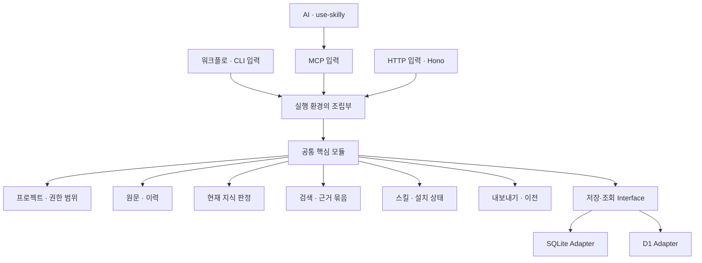
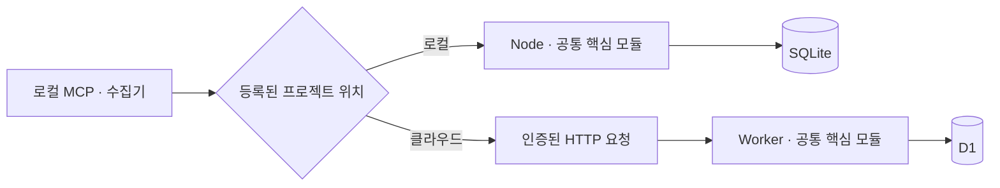
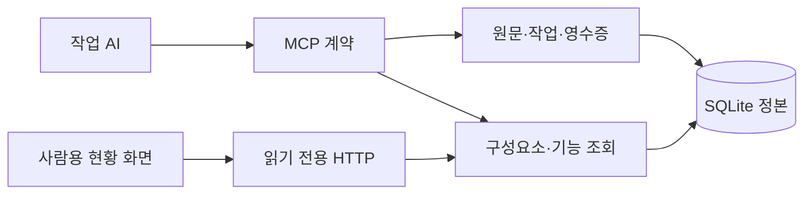

# Skilly 아키텍처

**기능별 모듈 + 얇은 요청 처리 + 교체 가능한 저장소 Adapter.**

2026-10-20 설계. 이 문서는 전체 목표 구조이며, 현재 로컬 MVP의 실제 지원 범위·명령·제한은 [개발·사용 안내](development.md)를 따른다. 제품의 판정 규칙과 전체 요구사항은 [제품 계획](product-plan.md), 목표 호출 예시는 [한 사이클](workflow.md), 용어는 [CONTEXT](../CONTEXT.md)를 따른다.

## 1. 선택한 패턴

TypeScript는 특정 설계 패턴을 강제하지 않는다. Skilly는 하나의 코드베이스에 기능별 모듈을 두고, 외부 연결을 Ports and Adapters 방식으로 분리한다.

요청 해석·개발·요약·기능 분류는 사용자가 실행 중인 Codex·Cursor가 담당한다. Skilly에는 AI 모델, 추론 서버, LLM API 호출 모듈을 두지 않는다. `knowledge`의 판정은 구조화된 근거의 출처·범위·소스 버전·대체 관계를 비교하는 코드 규칙이다. 자유로운 문장의 의미나 코드의 정확성을 자체 추론하는 기능이 아니다.

| 익숙한 개념 | Skilly에서 맡는 역할 |
|---|---|
| MVC의 Controller에 가까운 역할 | HTTP·MCP·CLI 입력 검증, 인증된 요청 정보 전달, 결과 변환 |
| 업무 처리와 Model에 가까운 역할 | 작업·기록·현재 지식·스킬·이전 규칙을 가진 핵심 모듈 |
| DB 접근 | 핵심 모듈이 정의한 Interface를 구현하는 저장소 Adapter |
| View | 구현된 로컬 HTML·CSS·JavaScript 화면. 조회 API와 명시적인 문서 가져오기·완료 확인 경로 사용 |

모듈마다 작은 공개 Interface를 두고 내부 규칙은 그 안에 모은다. 호출자가 SQL·현재성 판정 순서·트랜잭션 세부사항까지 알아야 하는 얇은 전달 계층을 반복해서 만들지 않는다.

목표 구조의 Hono 계층에서는 기능별 라우트를 조합한다. 현재 로컬 HTTP 화면은 Node
내장 서버를 사용하며 Hono 의존성은 없다. 어느 경로든 별도 Controller 클래스가 필수는
아니며 핸들러 안에서 업무 규칙을 늘리지 않는다. [Hono 권장 방식](https://hono.dev/docs/guides/best-practices)

## 2. 요청이 흐르는 방향



화살표는 호출 흐름이다. 코드의 의존 방향은 별도로 제한한다.

- `core`는 TypeScript 데이터와 자신이 정의한 Interface만 사용한다.
- `adapters`와 `transport`는 `core`의 공개 Interface를 사용한다.
- `runtime`은 실제 Adapter를 생성해 핵심 모듈에 주입한다.
- `core`는 Hono의 Context, Node의 파일 API, D1 바인딩, MCP SDK를 import하지 않는다.
- 다른 모듈의 테이블을 직접 수정하지 않는다. 함께 확정해야 하는 변경은 하나의 저장 계약으로 조정한다.

## 3. 실제 폴더와 구현 예정 폴더

현재 로컬 구현은 `core/memory`·`core/plans` 등의 규칙, `adapters/storage/sqlite`,
`transport/tools.ts`·`transport/mcp`·`transport/viewer`, `runtime/local`, `ui/`로 구성한다.
명시적 실행기와 화면 서버 관리도 `runtime/local`에 있다. 아래 트리는 목표 구조이며
실제 파일 목록이나 미구현 체크리스트가 아니다. 책임이 작은 기능을 맞춰 쪼개지 않는다.

```text
src/
├─ core/
│  ├─ projects/           프로젝트 식별 · 접근 범위 · 정본 위치
│  ├─ records/            작업 · 이벤트 · 원문 버전 · 수신 영수증
│  ├─ knowledge/          대체 · 철회 · 충돌 · 현재성 판정
│  ├─ retrieval/          기능 찾기 · 검색 순위 · 근거 묶음
│  ├─ skills/             패키지 버전 · 프로젝트 지정 · 설치 상태
│  └─ transfer/           사본 · 내보내기 · 검증 · 정본 전환
├─ adapters/
│  ├─ storage/
│  │  ├─ sqlite/          로컬 DB 연결과 트랜잭션
│  │  └─ d1/              D1 연결과 배치·버전 충돌 처리
│  ├─ assets/             파일 저장 · 해시 · 접근 가능 여부
│  └─ remote/             클라우드 Skilly 호출 · 오류 분류
├─ transport/
│  ├─ http/               Hono 라우트 · 입력 검증 · 응답 변환
│  ├─ mcp/                AI 도구 정의 · 도구 결과 변환
│  └─ cli/                설치 점검 · 복구 · 내보내기 명령
└─ runtime/
   ├─ local/              세션형 Node 실행 · DB 연결 · 로컬 큐
   └─ cloudflare/         Workers 실행 · D1 바인딩

integrations/
├─ skills/                use-skilly 패키지의 배포 위치
└─ collectors/            실행 환경별 허용된 이벤트 수집

migrations/               논리 버전과 저장소별 SQL 변경
tests/contracts/          SQLite·D1에 같은 저장 계약 검증
```

기능 모듈 안에서는 필요에 따라 `index.ts`(공개 Interface), `service.ts`(작업 순서), `model.ts`(자료와 규칙), `ports.ts`(외부 연결 계약)를 둔다. 작은 모듈에 네 파일을 억지로 만들지 않는다. SQL은 Adapter, 사용자의 업무 판단은 핵심 모듈에 둔다.

일반적인 “공용 코드” 폴더로 규칙을 몰아넣지 않는다. 모듈 간 공유가 필요한 값은 소유자를 정하고, 실제로 반복되는 안정된 책임만 별도 모듈로 분리한다. 초기에는 별도 서비스나 패키지로 배포하지 않는다.

## 4. 로컬과 클라우드 실행

개인 클라우드 첫 구현의 실제 지원 범위와 원자성·재시도 계약은
[클라우드 저장 계약](cloud-storage-contract.md)을 따른다. D1 저장 기반은 아직
전체 MemoryStore나 배포된 클라우드 서비스가 아니다.

| 모드 | 정본 DB | 핵심 코드 실행 위치 | 컴퓨터에 남는 것 |
|---|---|---|---|
| 로컬 | 로컬 SQLite | Node 프로세스 | DB·첨부·큐·기기별 연결 |
| 클라우드 | 첫 대상은 D1 | Cloudflare Worker | 기기별 연결·전송 대기 큐·선택적 캐시·로컬 원본 |
| 다른 서버 | 지원 Adapter를 연결한 저장소 | 해당 서버의 Skilly | 위와 같은 클라이언트 자료 |

로컬 사용과 클라우드 사용은 모두 지원 목표다. 처음 구현은 로컬에서 작은 작업 흐름을 검증하고, 같은 저장 계약을 D1에 적용한다. 한 DB에 여러 프로젝트를 넣을 수 있으며 프로젝트별로 다른 정본을 지정할 수도 있다.

개인용 첫 구현은 MCP STDIO 연결을 처리하는 Node 프로세스 안에 핵심 모듈과 SQLite Adapter를 함께 둔다. HTTP 서버와 별도 백그라운드 서비스는 필수가 아니다. 같은 연결에서 여러 프로젝트를 처리하며, 클라이언트가 여러 MCP 프로세스를 실행할 수 있다는 점은 자원 측정에 포함한다. 같은 로컬 DB에 접근하는 연결은 짧은 트랜잭션과 제한된 잠금 대기로 조정하고, 스키마 변경은 별도로 직렬화한다.



클라우드 모드에서 AI가 D1에 SQL을 직접 보내지 않는다. 로컬 연결 모듈이 Skilly 서버에 요청하고, 서버에서 인증·권한·판정을 수행한다. Cloudflare 관리용 자격증명을 AI 프롬프트나 클라이언트에 전달하지 않는다.

클라우드에 연결할 수 없으면 쓰기는 로컬 큐에서 대기한다. 캐시를 사용한 조회에는 확인 시점과 제한을 표시하며, 최신 확인을 못 한 사실을 현재 사실로 확정하지 않는다. 장애를 이유로 쓰기 정본을 자동 전환하지 않는다.

로컬 데이터 위치는 설치 시 운영체제의 사용자 데이터 영역 또는 사용자가 정한 경로로 결정한다. 코드 저장소와 분리하고, 여러 worktree의 개발 DB도 서로 분리한다.

## 5. 저장소를 교체할 수 있게 하는 Interface

아래 이름은 개념 계약이며 실제 TypeScript 코드와 확정된 공개 API가 아니다.

| Interface의 기능 | 숨기는 복잡성 | 반드시 지킬 조건 |
|---|---|---|
| `appendObservation` | 이벤트·원문·영수증·후속 작업 저장 | 같은 멱등 키는 같은 결과, 다른 내용이면 거부 |
| `readKnowledgeScope` | 범위·권한·스냅샷에 맞는 근거 조회 | 프로젝트 격리, 확인 시점 반환 |
| `commitKnowledgeChange` | 현재 포인터·이력·개정 번호 확정 | 예상 버전과 정본 세대 검사, 전부 반영 또는 전부 미반영 |
| `searchWithinScope` | 구조 색인·본문 검색 | 권한·프로젝트 범위 고정, 현재성은 별도 재검증 |
| `readTransferPage` | 고정된 이전 대상의 페이지 조회 | 같은 이전 스냅샷, 참조와 원래 ID 보존 |

범용 `Repository<T>`나 임의 SQL 실행 함수를 핵심 모듈의 공개 Interface로 만들지 않는다. 실제로 교체할 SQLite와 D1 사이에서 유지해야 하는 동작을 계약으로 정의한다.

**SQLite와 D1을 같은 드라이버처럼 취급하지 않는다.** SQLite의 네이티브 연결·파일 백업과 D1의 요청·배치는 다르다. D1 배치는 문장 실패 시 전체 롤백을 지원하지만, 조건부 UPDATE가 0행을 바꾼 상황은 별도의 버전 충돌 처리가 필요하다. 후속 쓰기까지 조건으로 묶고 동일한 계약 검사로 원자성을 입증해야 한다. 임의의 비동기 트랜잭션 콜백을 공통 기능으로 약속하지 않는다. [D1 배치 계약](https://developers.cloudflare.com/d1/worker-api/d1-database/)

판정은 “관련 상태 읽기 → 핵심 모듈에서 변경안 계산 → 예상 버전으로 확정”으로 나눈다. 버전이 달라지면 제한된 재조회·재계산 또는 명시적 충돌을 반환한다.

TypeScript 타입은 실행 중 들어오는 JSON을 검증하지 않는다. HTTP·MCP·가져오기 입력은 런타임 검증을 거친다. 인증된 행위자 정보는 연결에서 결정하고 입력 JSON의 주장으로 대체하지 않는다.

## 작업 기록의 두 가지 보기

하나의 기록 ID에 원문과 구조화 보고를 함께 저장한다. 작업하는 AI가 저장 시
사용자의 언어로 `report.title`, `summary`, `changes`, `limitations`, `next_steps`를
작성한다. 검사 결과는 `checks`에 실행·실패·미실행을 구분해 적는다. 별도 요약
모델이나 백그라운드 변환기는 실행하지 않는다.

`report.technical`은 선택적 기술 참조다. `files`, `symbols`, `commands`는 각
최대 8개의 400자 문자열, `record_ids`는 최대 8개 UUID, `context`는 최대 1200자다.
전체 보고의 기존 12 KiB 제한을 유지한다. 참조 ID의 존재나 명령 실행을 이 필드가
입증하지 않는다. 기존 `body` 또는 종료 `summary` 원문과 저장 영수증은 보존한다.

화면은 사람용 요약을 먼저 표시하고 AI용 JSON과 원문을 각각 접어 제공한다.
AI는 범위가 제한된 검색/개요 후 `memory_get_evidence`로 같은 기록의 보고와
원문을 조회한다. 저장된 명령어는 데이터이며 실행 지시가 아니다. 새 필드는 현재
MCP 스키마에 노출된 경우에만 사용한다. 새 필드를 읽는 MCP·화면은 현재 빌드의
새 서버 프로세스로 시작해야 한다. 이전 서버에 클라이언트만 재연결하면 갱신되지
않으며, 이전 엄격한 보고 스키마는 새 기술 필드가 있는 기록을 읽지 못할 수 있다.

보고와 기술 필드는 하위 호환을 위해 선택 사항이다. 과거 원문만 있는 기록에 요약을
합성하거나 필드를 소급 추가하지 않는다. 생략된 필드에 기본값을 넣지 않아 이전
재시도 입력·해시를 보존한다. 저장·마감·검사 성공 보고는 내용의 자동 검증이 아니다.

## 6. 데이터 이전과 호환성

**로컬 → 클라우드, 클라우드 → 로컬, 다른 컴퓨터·서버로의 이전을 제품 기능으로 만든다.**

공통 교환 형식은 특정 업체의 DB 파일이 아니라 버전이 있는 논리 자료 묶음이다.

```text
project-export/
├─ manifest.json          형식 버전 · 프로젝트 · 파일 목록 · 해시 · 포함 범위
├─ data/
│  ├─ records.ndjson      원문과 버전
│  ├─ knowledge.ndjson    판정 이력과 근거 연결
│  └─ ...                 주제 · 작업 · 스킬 · 관계
└─ assets/                반출 가능한 첨부 · 고정 버전의 스킬 파일
```

- 논리 ID·원문 버전·관측 시각·출처를 보존한다. 설치 경로·사용자 권한·서버 연결은 목적지에 맞게 다시 매핑한다.
- 정수 정밀도에 의존하지 않는 문자열 ID와 명시적인 시간 형식을 사용한다. 형식 버전과 스키마 변환 가능 여부를 가져오기 전에 확인한다.
- 검색 색인·답변 캐시는 옮기지 않고 목적지의 허용된 자료에서 다시 만든다.
- 로컬 SQLite 사본이 필요하면 논리 자료 묶음에서 새 DB를 생성한다. 해당 결과는 별도 편의 산출물이며 유일한 교환 형식이 아니다.
- SQLite의 일관된 전체 백업은 별도 복구 기능이다. 프로젝트별 이동·타 DB 이전과 구분한다.
- 내보내기 중 프로젝트 쓰기를 고정하고, 불변 버전의 공유 자료를 포함한다. 긴 원격 읽기 전체를 하나의 DB 트랜잭션으로 유지한다고 가정하지 않는다.
- 원본을 동결할 수 없으면 읽기 전용 사본인지, 정본 이전인지에 맞는 안전한 스냅샷을 확보할 때까지 완료를 표시하지 않는다.

D1은 FTS5를 지원하지만 가상 테이블이 있는 DB의 기본 내보내기에는 제약이 있다. 따라서 검색 색인을 제거하며 운영 DB를 내보내는 방식에 의존하지 않고, Skilly의 논리 내보내기를 사용한다. [D1 내보내기 제약](https://developers.cloudflare.com/d1/best-practices/import-export-data/)


프로젝트별 정본은 하나다. 동결·대상 검증·쓰기 세대 전환은 재개 가능한 상태로 남긴다. 대상에서 새 쓰기가 시작된 뒤 예전 DB로 단순 복귀하지 않는다. 세부 실패 복구·지연 이벤트·공통 자료 처리 규칙은 [제품 계획의 이전 절차](product-plan.md#134-독립-이전의-처리-순서)를 따른다.

로컬 녹음 등 공유하지 않은 파일은 `local-only`로 표시한다. 완전한 이전에 필요한 첨부가 없으면 누락을 보고하며, 제한된 텍스트 사본과 완전한 이전을 구분한다.

## 7. 빠르고 가볍게 만드는 기준

아래는 제품의 실행 목표다. 로컬 MVP에서 구현한 상한과 아직 없는 큐·첨부·유지보수 기능은 [개발·사용 안내](development.md)에서 구분한다. 제한된 합성 자료의 측정값으로 모든 목표를 달성했다고 판단하지 않는다.

### 7.1 평소 하는 일과 하지 않는 일

일상적인 작업은 **시작 시 관련 기록 조회 → 중요한 실행 결과 저장 → 작업 AI가 작성한 요약 저장**이다. 모든 대화·키 입력마다 DB를 조회하거나 전체 이력을 다시 분석하지 않는다.

| 역할 | 실행 주체 | 실행 시점 |
|---|---|---|
| 요청 이해, 코드 수정·테스트, 요약·별칭 작성 | 기존 Codex·Cursor와 개발 도구 | 원래 개발 작업 안에서 |
| 범위가 제한된 검색, 기록·인덱스 갱신, 현재성 규칙 검사 | Skilly | 도구 요청 또는 허용된 이벤트 수신 시 |
| 선택 MD 일괄 가져오기·프로젝트 내보내기 | 명시적 가져오기·이전 경로 | 사용자가 요청한 자료만. 전체 색인 재구성은 목표 범위 |
| 음성 → 텍스트 | 사용자가 나중에 연결한 개인 로컬 변환기 | 사용자가 변환을 실행했을 때만 |

Skilly는 자체 요약 생성, 임베딩 생성, AI 분류 재시도 작업을 실행하지 않는다. 작업 AI가 분류를 보내지 않으면 미분류 상태와 원문 검색을 제공한다. Skilly에 AI API 키를 등록할 필요가 없다. 기존 작업 AI가 기록 도구를 사용하는 만큼의 컨텍스트·도구 호출 비용은 별도로 존재하므로 전달량도 제한한다.

### 7.2 프로세스와 대기 상태

- 기본은 세션형 MCP 실행이다. 연결이 살아 있는 동안 프로세스 메모리는 남을 수 있지만, 입력이 없고 재시도할 기록도 없으면 응용 코드의 주기적 DB 조회·폴더 스캔·네트워크 요청은 0회다.
- 프로젝트별 상주 프로세스를 만들지 않는다. 여러 프로젝트는 같은 MCP 연결의 요청 범위로 구분한다. 여러 AI 클라이언트가 연결되면 프로세스가 늘어날 수 있으며, 실제 합산 사용량을 표시·측정한다.
- 연결 종료 시 진행 중 쓰기를 마무리하거나 디스크에 보존한 뒤 DB와 프로세스를 정리한다. 사용 중인 STDIO 연결을 자체 유휴 타이머로 끊지 않는다. 강제 종료 이전에 수신·보존하지 못한 이벤트까지 복구됐다고 주장하지 않는다.
- 훅·워크플로 수집은 전달받은 완료 이벤트를 처리하는 짧은 실행 경로로 둔다. 전체 저장소 감시, OS 로그인 시 자동 상주, 독립적인 큐 소비 데몬은 첫 버전에 넣지 않는다.
- 코드·설치 상태는 작업 시작, 관련 파일 변경 통지, 실제 조회 시 필요한 경로만 확인한다. `node_modules`, 빌드 산출물, 전체 Git 객체, 비밀 파일을 순회하지 않는다. 관측이 부족하면 최신 상태를 추정하지 않고 재확인 필요로 반환한다.
- 로컬 정상 쓰기는 같은 트랜잭션에서 원문과 필요한 색인을 갱신한다. 클라우드 전송 대기나 연결 전 수집에 필요한 큐는 디스크에 둔다. 큐 때문에 모든 이벤트를 메모리에 올리지 않는다.
- 재전송은 활성 세션의 연결·새 작업 시작 또는 명시적 복구 요청에서 재개한다. 한 재개 주기의 자동 재시도는 최대 3회이며 지수 백오프·서버의 재시도 가능 시각을 따른다. 다음 요청도 기존 대기 시간을 우회하지 않는다. 세션이 없으면 큐는 다음 연결까지 보존된다.

여러 클라이언트의 중복 프로세스 비용이 실제로 문제가 될 때 공유 로컬 서비스 구조를 검토한다. 이 경우에도 MCP 연결 프로그램을 포함한 전체 비용을 비교하며, 처음부터 별도 서비스 관리 계층을 만들지 않는다.

### 7.3 처리량과 저장량의 상한

아래 값은 **첫 구현에서 적용·측정할 기본값 초안**이다. 성능 측정 결과가 아니며, 구현 시 한 설정 계약으로 관리하고 변경 근거를 남긴다.

| 대상 | 초기 기본값 | 상한에 도달했을 때 |
|---|---|---|
| 일반 기록 요청 | 인코딩된 JSON 최대 128 KiB | 파싱 전 크기 제한, `payload_too_large`; 큰 자료는 별도 첨부·가져오기 경로 사용 |
| 컨텍스트 조회 | 기본 10건, 최대 50건, 전체 JSON 최대 32 KiB | 근거 ID·상태·페이지 정보를 포함해 예산 계산; 추가 자료는 커서로 조회 |
| 원문·스킬 전문 조회 | 응답 페이지 최대 128 KiB | 파일·구간을 나눠 완전한 버전을 받을 수 있게 반환 |
| 프로세스 내 대기 요청 | 최대 32개 및 입력 합계 1 MiB 중 먼저 도달하는 한도 | `busy`와 재시도 정보; 메모리 대기를 무한히 늘리지 않음 |
| DB 쓰기 | 프로세스당 1건씩 처리, 잠금 대기 최대 1초 | 로컬 큐 보존에 성공하면 `queued`, 그마저 실패하면 명시적 저장 오류 |
| 전송용 디스크 큐 | 기기 데이터 영역 전체 128 MiB | `queue_full`; 기존 미전송 자료를 몰래 버리거나 저장 성공으로 응답하지 않음 |
| 앱의 본문·검색 결과 캐시 | 첫 버전 비활성 | 필요할 때만 바이트·개수 상한을 가진 캐시 도입 |
| 후속 유지보수 | 한 번에 1개, 한 묶음 최대 100건 또는 1 MiB | 페이지 단위 진행·취소·재개, 일반 작업이 들어오면 다음 묶음 대기 |

일반 쓰기 경로에서 스킬 전문·큰 출력·첨부를 매번 중복 저장하지 않는다. 내용 해시와 불변 버전을 참조한다. 결과를 잘라낼 때는 `truncated`와 다음 조회 방법을 포함하며, 잘린 결과를 전문이나 완전한 검색 결과로 표시하지 않는다.

DB의 원문·이력은 자원 상한을 이유로 자동 삭제하지 않는다. 큐에서 수신 완료된 자료와 재생성 가능한 캐시의 정리는 별도 보존 정책을 따른다. DB·색인·첨부·미전송 큐의 크기를 각각 확인할 수 있게 한다.

상한은 입력·출력·대기량을 제한하는 값이지 프로세스 전체 메모리의 강제 상한은 아니다. DB 페이지 캐시, 런타임, 동시 연결 비용까지 아래 실측으로 확인한다. 동기식 DB·파일 작업이 오래 걸리면 입력 크기와 쿼리 계획부터 줄이고, 별도 실행부는 측정된 병목이 있을 때 도입한다.

### 7.4 측정 조건과 첫 성능 목표

첫 기준 데이터는 20개 프로젝트, 총 10,000개 기록, 기록당 평균 본문 2 KiB로 만든 합성 자료다. 장비·OS·Node·DB 드라이버 버전과 실제 DB·색인 크기를 결과에 기록한다.

| 지표 | 초기 목표와 측정 방식 |
|---|---|
| 대기 CPU | 큐가 비어 있는 연결에서 60초 측정, Skilly 프로세스 합계가 한 코어 기준 평균 0.5% 이하 |
| 메모리 | 단일 MCP 연결의 시작·작업 중 최고·작업 후 안정 시 RSS 기록, 작업 후 안정 시 100 MiB 이하 목표 |
| 로컬 조회 | 워밍업 후 동일 크기 조건의 조회 100회, MCP 요청부터 JSON 반환까지 p95 200 ms 이하 목표 |
| 로컬 기록 | 최대 8 KiB의 일반 이벤트 100회, 수신부터 DB 확정까지 p95 100 ms 이하 목표; 큐 수신 시간과 구분 |
| 반복·동시 사용 | 작업 1,000회 반복 후 안정 시 메모리, 2개 클라이언트의 합산 자원·잠금 충돌·큐 상한 확인 |
| 기존 개발에 미치는 영향 | 동일 코드·환경의 대표 빌드/테스트를 연동 없이/연동해서 각 5회 실행해 중앙값 비교, 5% 초과 지연은 원인 확인 |

성능 목표는 출시 전 판단 기준이며 현재 달성된 수치가 아니다. 클라우드 모드는 네트워크 왕복과 Worker 처리 시간을 별도로 측정하고 로컬 목표와 섞지 않는다. 목표를 넘기면 원인을 기록하고 설계·제한값을 조정한 뒤 다시 검증한다.

Cloudflare Free 한도는 요청 횟수뿐 아니라 CPU와 DB 행 처리량·용량에도 적용된다. 한도 도달 시 `quota_exceeded`와 재시도 가능 여부를 반환하고 로컬 큐에 보존한다. 자동 유료 전환은 하지 않는다. 요금과 한도는 배포 직전에 다시 확인한다. [Workers 요금](https://developers.cloudflare.com/workers/platform/pricing/), [D1 요금](https://developers.cloudflare.com/d1/platform/pricing/), [D1 한도](https://developers.cloudflare.com/d1/platform/limits/)

## 서비스 현황 조회 경계

`core/work`는 구성요소·기능·구조화 보고 계약을 정의한다. 기록 원문과 저장 성공
판정은 기존 memory 모듈에 남긴다. `sqlite/work`의 읽기 모델을 MCP의 서비스 조회와
HTTP 화면이 함께 사용하며, 화면은 쓰기 서비스를 생성하지 않는다.



v4 확장은 sidecar 테이블을 사용해 이전 runs/records/receipts 열과 원문을 유지한다.
연결과 요약도 기록·영수증과 같은 트랜잭션에 포함한다. 선택 필드의 기본값 주입이나
과거 기록의 추정 분류를 하지 않는다. 기존 프로세스의 원래 요청 재생은 보존하지만
v3까지만 아는 이전 실행 파일을 새로 시작하면 v4를 거부하므로 연결을 최신 코드로 갱신한다.

`component`는 연결 선언, `repository`는 기존 기록 범위, `branch`는 소스 브랜치다.
서비스 전체 조회는 별도의 읽기 도구에서 명시적으로 요청하고 기존 기록 쓰기·복구의
저장소/환경 경계를 완화하지 않는다. 기능의 최근 보고는 현재 사실 자동 판정이 아니다.

## 8. 구현할 때의 검증 경계

| 검증 대상 | 확인할 결과 |
|---|---|
| 핵심 모듈 Interface | 오래된 기록·충돌·출처 부족을 현재 사실로 확정하지 않음 |
| 저장소 계약 | SQLite·D1이 같은 멱등성·버전 충돌·원자성·프로젝트 격리를 만족 |
| 전달 계약 | MCP와 HTTP가 같은 의미의 입력·결과·오류를 전달 |
| 이전 계약 | 로컬 ↔ 클라우드 왕복 후 원문·이력·근거 연결 보존 |
| 장애 복구 | 중단·응답 유실·중복 전송·무료 한도 초과에서 상태를 정확히 표시 |
| 자원 제한 | 대기 중 응용 폴링 없음, 입력·출력·큐 상한, 과부하·재시도 중 보존 상태 확인 |
| 성능 | 7.4절 조건으로 검색 계획·응답 크기·지연·합산 CPU·메모리·개발 작업 영향 측정 |

기능을 구현한 시점에 해당 동작을 검사한다. 첫 로컬 구현의 저장 계약·MCP 테스트는 `tests/`에 있으며, D1·실제 실행 관측·전체 성능 목표는 해당 구현 시 검증한다.

## 이번 설계 작업의 계약

아래는 설계 문서 정리 작업의 계약이다. 후속 로컬 구현의 중간 위험도 계약과 검증은 [개발·사용 안내](development.md)에 별도로 둔다.

```yaml
mode: change
risk: low
goal: 기존 작업 AI와 Skilly의 역할을 명확히 하고 저자원 실행 기준을 설계 문서에 반영
non_goals: [앱 구현, 패키지 설치, DB 생성, 스킬 설치, 클라우드 배포, 커밋, push]
affected_repositories: [Skilly]
constraints:
  - 기존 Flamingo Review 파일 보존
  - 실제 기록·첨부·자격증명 복사 금지
  - TypeScript 기반, 로컬·클라우드 공통 규칙과 교체 가능한 저장소
  - Skilly 자체 AI 모델·LLM API 호출·자동 추론 작업 없음
acceptance_criteria:
  - 기존 계획의 최신성·검색·스킬·다중 프로젝트 요구사항 보존
  - 로컬·클라우드 실행과 양방향 이전 설계 명시
  - 기능별 책임·의존 방향·한 작업의 입력과 결과를 설명
  - 설계와 구현 완료 상태 구분
  - 세션 수명·대기 동작·처리량 상한·향후 성능 측정 조건 명시
verification: [변경 diff 확인, 로컬 링크·문서 형식·예제 JSON 확인, git 상태 확인]
required_user_decisions: []
```

## 계획·체크리스트 모듈

`core/plans`는 항목·완료 조건 검증, 선택 MD 체크리스트 파싱, 진행률 계산을 담당한다. `adapters/storage/sqlite/plans`는 불변 버전·진행 이력·범위 검사·멱등 영수증·원자 저장을 제공한다. MCP와 읽기 전용 viewer가 같은 계획 조회를 사용하며 작업·실행 근거 모듈을 대체하지 않는다. 원문/버전과 현재 진행 투영을 분리한다. [계약](plans.md)을 따른다.
