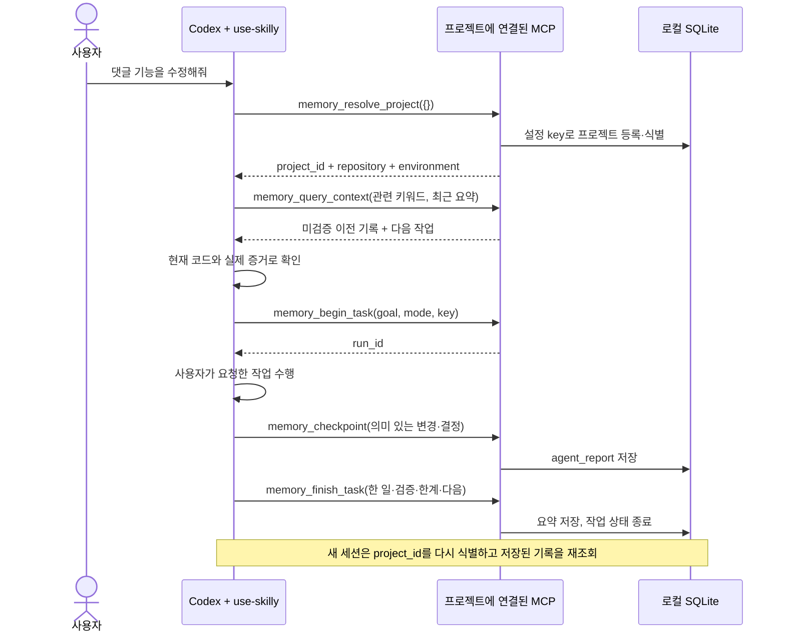

# Codex에서 Skilly 사용하기

Skilly는 **Codex가 필요할 때 호출하는 로컬 MCP 서버**다. Codex의 `use-skilly`
스킬이 작업 전 조회와 작업 중·종료 기록을 담당한다. 사용자가 매번 DB 명령을
입력할 필요는 없다. 다만 스킬 호출은 AI의 지침 수행이며, 모든 이벤트를 강제로
저장하는 수집기는 아니다. 중단·도구 미연결·스킬 미호출 시 기록이 빠질 수 있다.

## 지원 방식 확인

2026-10-20 공식 문서와 로컬 `codex-cli 0.144.4` 명령·생성 프로토콜을 확인했다.

| 방식 | 이번 구현 |
|---|---|
| 프로젝트 `.codex/config.toml`의 stdio MCP | 지원 형식으로 생성. 프로젝트 설정은 Codex가 신뢰하는 프로젝트에서만 로드 |
| `.agents/skills/use-skilly/SKILL.md` | 공식 스킬 탐색 경로에 설치. `AGENTS.md`에서 일반 프로젝트 작업에 사용하도록 안내 |
| 명시적 `$use-skilly` / 설명에 따른 자동 선택 | 스킬 사용 방식. 자동 선택·매번 실행을 보장하지 않음 |
| SessionStart / Stop / PostToolUse 훅 | 이번에는 설치하지 않음. 별도 훅 신뢰 승인이 필요하며 SessionStart가 MCP 준비 전에 실행될 수 있음 |
| app-server `skills/list`, `mcpServer/tool/call` | 설치된 CLI가 생성한 프로토콜로 확인. 모델 호출 없이 실제 연결을 점검하는 용도 |

근거: [공식 MCP 설정](https://learn.chatgpt.com/docs/extend/mcp),
[공식 스킬 탐색·호출](https://learn.chatgpt.com/docs/build-skills),
[공식 훅 및 신뢰 규칙](https://learn.chatgpt.com/docs/hooks).

## 한 번의 작업 흐름



AI가 “테스트 통과”라고 기록해도 Skilly가 실제 실행을 관측한 것은 아니다.
기록은 계속 `provenance: agent_report`, `knowledge_status: unknown`,
`verified: false`다. `completed`는 작업 종료 상태이며 검증 성공을 뜻하지 않는다.
`current_knowledge`는 자동 관측 근거가 없으므로 비어 있다.

새 세션은 다른 세션의 진행 중 작업을 임의로 이어 쓰지 않고 새 `run_id`를 만든다.
현재 대화가 이미 소유한 작업 ID만 상태를 확인해 이어 쓸 수 있다. 종료 전에
프로세스가 끊기면 저장된 체크포인트까지만 남으며, 가짜 마감이나 대기 큐를 만들지 않는다.

## 프로젝트 식별과 설치

저장소 루트의 `skilly.project.json`은 이동 가능한 식별 정보다.

```json
{
  "version": 1,
  "key": "skilly",
  "name": "Skilly",
  "repository": "main",
  "environment": "development"
}
```

- `key`는 DB 내 프로젝트 식별자다. 다른 프로젝트는 서로 다른 key를 사용한다.
- 같은 프로젝트의 다른 체크아웃·워크트리는 같은 key를 사용한다. 폴더 경로로 추측하지 않는다.
- `repository`는 논리적인 저장소 이름이다. 브랜치명이 아니며 다른 저장소는 다른 값을 쓴다.
- 같은 key에 다른 name을 주면 오류로 중단한다. 이름 변경·프로젝트 병합은 아직 지원하지 않는다.
- 파일은 최대 4 KiB이며 임의 필드·심볼릭 링크·비정규 파일은 허용하지 않는다.
- DB 경로·실행 명령·비밀 값은 이 파일에 넣지 않는다.

```sh
npm run setup:codex -- \
  --project /absolute/project \
  --db /absolute/local/memory.sqlite
```

Skilly 패키지 폴더에서 실행한다. 대상 프로젝트에는 먼저 식별 파일을 둔다.
설치기는 로컬 `.codex/config.toml`과 `.agents/skills/use-skilly`를 생성한다.
설치 성공 응답의 `connection_verified: false`는 **설정 생성만 끝났다**는 의미다.

기존 Codex 설정이나 스킬이 있으면 내용을 읽거나 덮어쓰지 않고 중단한다.
기존 설정에 추가해야 할 때는 아래 항목만 검토해 병합한다. 실패 중 일부 파일이
생성됐다면 그대로 보존되며 삭제·자동 덮어쓰기 없이 알려진 대상부터 확인한다.

```toml
[mcp_servers.skilly]
command = "/absolute/path/to/node"
args = ["/absolute/Skilly/dist/runtime/local/main.js", "serve", "--project", "/absolute/project", "--db", "/absolute/local/memory.sqlite"]
cwd = "/absolute/project"
startup_timeout_sec = 10
tool_timeout_sec = 10
```

생성 설정은 기기별 절대 경로를 포함한다. 저장소·Node 경로를 옮기면 설정을
다시 맞춰야 한다. DB 파일의 이동·동기화·export/import는 이 설치기가 수행하지 않는다.
여러 프로젝트가 같은 DB를 지정해도 각 연결은 자신의 프로젝트·저장소·환경으로 제한된다.
이 제한은 로컬 실수 방지이며 여러 사용자를 위한 인증·권한 시스템은 아니다.

다른 저장소에서 일관된 자동 사용을 원하면 그 저장소의 기존 `AGENTS.md`에
“일반 프로젝트 작업의 시작과 종료에 use-skilly를 사용한다”는 지침을 합의해 추가한다.
설치기는 다른 프로젝트의 지침 파일을 수정하지 않는다.

## 구현 경계

| 위치 | 책임 |
|---|---|
| `src/adapters/project/binding.ts` | 지정된 루트의 식별 파일만 제한된 크기로 읽기 |
| `src/core/memory/binding.ts` | 프로젝트 식별 및 요청의 프로젝트·저장소·환경 일치 확인 |
| `src/core/memory/service.ts` | 기존 작업·기록·이력 규칙. SQLite schema 변경 없음 |
| `src/transport/tools.ts` | 기존 JSON 계약 유지, 연결 범위에 맞는 기본값 |
| `scripts/setup-codex.mjs` | 로컬 MCP 설정과 스킬 설치. 기존 설정 보존 |
| `integrations/skills/use-skilly` | Codex가 수행할 조회·기록·마감 절차 |
| `scripts/verify-codex.mjs` | 실제 Codex 프로토콜 연결 점검. 일반 테스트와 별도 실행 |

`--project` 없는 기존 CLI/MCP는 기존 8개 도구를 유지한다.
프로젝트 연결 모드에서는 등록·프로젝트 목록 대신 `memory_resolve_project({})`를
노출해 총 7개 도구를 제공한다. 조회·기록 도구의 기존 `project_id` 계약은 유지한다.
설정 범위와 다른 프로젝트·repository·environment·작업·원문 접근은 거부한다.
`memory_resolve_project`만 최초 프로젝트를 등록하며 조회 요청은 등록하지 않는다.

파일 감시·상시 폴링·별도 AI·전체 디스크 탐색을 추가하지 않았다. MCP는
클라이언트 연결 동안만 살아 있고 표준 입력이 닫히면 종료한다. 기존 요청/응답
크기 제한과 동시 처리 제한을 그대로 적용한다.

## 검증 방법과 실제 확인 범위

`npm test`는 임시 DB와 MCP SDK 클라이언트로 계약을 검사한다. Codex AI가
스킬을 실제로 선택했다고 증명하는 테스트가 아니다.

수동 실제 연결 점검은 macOS에서 다음과 같이 실행한다.

```sh
node scripts/verify-codex.mjs \
  --project /absolute/project \
  --db /absolute/local/memory.sqlite \
  --codex /absolute/path/to/codex
```

이 명령은 지정 DB에 **합성 연결 점검 기록**을 남긴다. 사용자 자료를 삭제하지 않는다.
OS 샌드박스로 네트워크를 차단하며, 명시적 MCP 테스트 설정으로 두 개의
Codex app-server 프로세스를 차례로 실행한다. 모델 턴·외부 전송·신뢰 설정 변경은 없다.
첫 프로세스가 저장·마감하고 두 번째 프로세스가 같은 프로젝트와 기록을 재조회한다.

결과 필드는 구분해서 읽는다.

| 필드 | 의미 |
|---|---|
| `effective_mcp_config_matches` | 실제 CLI의 적용된 설정이 기대한 MCP와 같은가. 설정의 원본 계층까지 증명하지 않음 |
| `sessions[].skill_discovered` | Codex가 설치된 스킬을 발견했는가 |
| `sessions[].mcp_connected` | 해당 실행 모드의 설정에서 실제 Codex MCP 연결이 됐는가 |
| `requery_verified` | 별도 프로세스에서 합성 기록 재조회가 확인됐는가 |
| `stored_claims_verified` | 항상 false. 저장한 주장 자체를 검증하지 않음 |
| `implicit_skill_execution_verified` | false. 모델 턴을 실행하지 않으므로 자동 스킬 수행은 미확인 |
| `desktop_current_session_verified` | false. 기존 데스크톱 채팅의 재연결은 별도 확인 필요 |

`--configured`를 추가하면 명시적 MCP 설정을 주입하지 않고 설치된 설정의
스킬·도구 발견만 검사한다. 이 모드는 연결 대상 DB를 단정할 수 없으므로
기록을 쓰는 도구를 호출하지 않는다. MCP 프로세스 시작 자체는 설정된 로컬 DB를
열거나 초기화할 수 있다. Skilly 서버가 없으면 실패 상태와 종료 코드 1을 반환한다.
두 모드 모두 Codex 배포본의 내장 서버가 목록에 나타날 수 있지만 호출하지 않는다.

프로젝트 설정이 발견되지 않으면 Codex의 프로젝트 신뢰 상태와 프로젝트 경로,
새 세션에서의 MCP 연결을 확인해야 한다. 설치기가 신뢰 상태를 임의 변경하지 않는다.
설정 인식·통신·AI 자동 실행을 한 항목의 “연동 성공”으로 합치지 않는다.

### 2026-10-20 확인 결과

환경: macOS, Node.js 25.2.1, Codex CLI 0.144.4.

| 확인 | 결과와 한계 |
|---|---|
| `npm test` | 21/21 통과. 기존 17개 + Codex 연동 계약 4개 |
| `npm run typecheck` | 통과. 독립 리뷰에서도 실행 |
| 스킬 `quick_validate.py integrations/skills/use-skilly` | 통과 |
| `git diff --check` / `node --check scripts/verify-codex.mjs` | 통과 |
| 독립 읽기 전용 리뷰 | 조회의 등록 부작용·FIFO 열기 대기를 수정하고 회귀 검사. 설정 출처 과장 표시도 정정 |
| 명시적 설정의 실제 Codex 연결 | 별도 app-server 프로세스 2개에서 스킬 발견, MCP 7개 연결, 저장·마감·재조회 성공 |
| 설치된 설정만 이용한 연결 (`--configured`) | **연결 성공**. 사용자 승인으로 프로젝트 신뢰 항목 추가 후 별도 프로세스 2개에서 스킬과 MCP 7개 발견, 설정 일치 true, 신뢰 경고 false, 종료 코드 0 |
| 모델의 자동 스킬 선택·일반 요청 전체 사이클 | 미실행. 모델 턴 0회 |
| 현재 데스크톱 채팅의 MCP 연결 | 미확인 |

명시적 연결 점검에 사용한 명령:

```sh
node scripts/verify-codex.mjs \
  --project /Users/yeop/project/Skilly \
  --db /Users/yeop/project/Skilly/.skilly/memory.sqlite \
  --codex /Users/yeop/.local/bin/codex
```

설치 설정 점검에는 위 명령에 `--configured`를 추가했다.
네트워크는 OS에서 차단했다. 로컬 DB에는 연결 점검용 합성 기록만 저장했으며,
실제 개발 성과나 검증 근거로 표시하지 않았다. 최초 기본 구현은 `cffb370`으로
커밋했고 이번 Codex 연동 변경은 별도 작업 트리에 남겼다.

프로젝트 신뢰 설정과 설치 설정 연결 확인은 완료했다. 다음 검증은 새 세션에서
일반 작업을 요청했을 때 스스로 기록하고, 별도 세션에서 그 기록을 다시 사용하는지 확인하는 것이다.
벤치마크·최소 Node 24 런타임·장시간 운영 검사는 이번 변경에서 다시 실행하지 않았다.

### 신뢰 설정 반영 과정

사용자가 프로젝트 신뢰 확인을 완료했다고 알린 뒤 같은 `--configured` 명령을
재실행했다. 여전히 종료 코드 1, `effective_mcp_config_matches: false`,
`project_config_trust_warning: true`였고, 스킬만 발견됐다. 현재 채팅의
도구 목록에도 Skilly MCP는 없었다. 이전의 명시적 설정 테스트 성공과 구분한다.

Codex app-server의 실제 `configWarning`이 지목한 경로는
`/Users/yeop/project/Skilly/.codex`였다. 경고는 사용자 설정 파일
`/Users/yeop/.codex/config.toml`에서 `/Users/yeop/project/Skilly`를
신뢰 프로젝트로 등록해야 한다고 안내했다. 개인 설정 파일의 내용은 읽거나 변경하지 않았다.

사용자가 확인할 항목은 아래와 같다. 같은 프로젝트 항목이 이미 있다면 중복으로
추가하지 말고 기존 값을 확인한다. 저장소 안의 `.codex/config.toml`에 넣는 값이 아니다.

```toml
[projects."/Users/yeop/project/Skilly"]
trust_level = "trusted"
```

설정 형식 근거: [공식 프로젝트 신뢰 설정](https://learn.chatgpt.com/docs/config-file/config-reference),
[공식 설정 예제](https://learn.chatgpt.com/docs/config-file/config-sample).
반영 후 새 Codex 프로세스의 설치 설정 연결을 다시 확인해야 한다. 이번 재검사는
모델 호출·새 작업 기록 없이 진행했으며, 애플리케이션 코드는 바꾸지 않아 전체 테스트를
다시 실행하지 않았다.

이후 사용자가 해당 항목을 직접 추가하도록 명시적으로 승인했다.
Codex `config/value/write`로 위 프로젝트의 `trust_level` 한 값만 `trusted`로
설정했고 성공 응답을 받았다. 독립 검증자가 `--configured`를 다시 실행한 결과,
두 프로세스 모두 스킬과 MCP 도구 7개를 발견했다. 적용된 MCP 설정도 일치했고
프로젝트 신뢰 경고가 사라졌다. 이는 설치 설정의 연결 검증이며, 모델 턴은 0회이므로
일반 작업 중 자동 기록과 다음 세션 활용까지 증명한 결과는 아니다.

## 이번 변경의 계약

```yaml
mode: change
risk: medium
goal: Codex의 프로젝트 식별, 일반 작업 기록, 다음 세션 재조회를 로컬 MCP와 스킬로 연결
non_goals: [클라우드 배포, 외부 전송, 데이터 삭제, 명령 결과 자동 수집, 훅 설치, 모델 호출]
affected_repositories: [Skilly]
constraints: [기존 API·DB 스키마 유지, 기존 설정 보존, 미관측 주장 미검증 유지]
acceptance_criteria:
  - 명시적 프로젝트 식별 파일로 같은 프로젝트를 재식별
  - 다른 프로젝트·저장소·환경 접근 거부
  - 시작·기록·마감 후 새 연결에서 재조회
  - 설치 결과·계약 테스트·실제 Codex 연결·AI 자동 수행 결과를 구분
verification: [TypeScript, 임시 DB 계약 테스트, MCP 통합 테스트, 독립 읽기 전용 리뷰, 네트워크 차단 Codex 연결 점검]
required_user_decisions: [프로젝트 신뢰가 필요한 경우 Codex에서 직접 확인, 외부 전송을 포함한 모델 기반 전체 사이클은 별도 승인]
```
