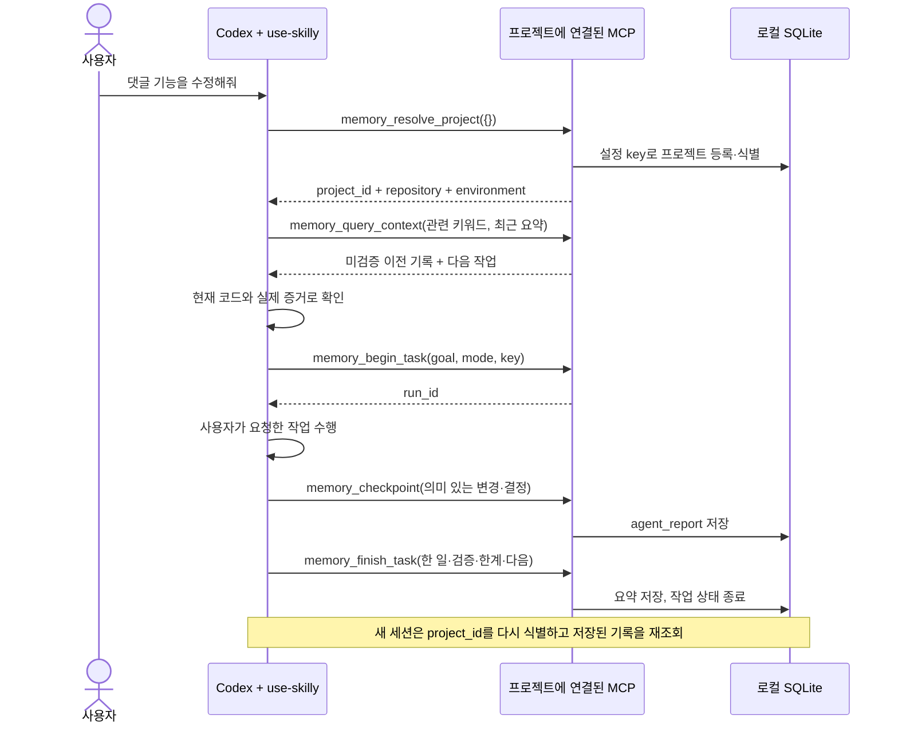

# Codex에서 Skilly 사용하기

Skilly는 **Codex가 필요할 때 호출하는 로컬 MCP 서버**다. Codex의 `use-skilly`
스킬이 작업 전 조회와 작업 중·종료 기록을 담당한다. 사용자가 매번 DB 명령을
입력할 필요는 없다. 다만 스킬 호출은 AI의 지침 수행이며, 모든 이벤트를 강제로
저장하는 수집기는 아니다. 중단·도구 미연결·스킬 미호출 시 기록이 빠질 수 있다.
일상적인 사용과 직접 저장 확인 명령은 [사용 안내](user-guide.md)에 있다.
현재 지침은 기록을 사용하는 일반 구현을 시작 저장 성공 전에는 진행하지 않는다.
도구 미노출·시작 저장 실패·체크포인트 실패 시 추가 구현을 멈춘다.
사용자의 기록 거부, 읽기 전용 답변, 명시적으로 요청한 연결 수리는 별도로 처리한다.
새 서버의 복구 도구 2개는 보관된 원래 저장 요청을 확인·재시도한다.
재연결과 소급 보고의 구분은 [복구 안내](recovery.md)를 따른다.

현재 사용법은 이 문서의 [설치](#프로젝트-식별과-설치), [진단](#첫-설치와-연결-문제-진단),
[화면 재시작](#재실행과-화면-연결)을 따른다. 구현된 로컬 기능과 실제 앱·설치·이동의
미검증 범위는 [현재 지원 범위](development.md#현재-로컬-기능과-확인-범위)에서 구분한다.
[초기 검증 이력](#초기-연동-검증-이력-보존)에 남은 “현재 채팅”, 도구 수와 버전은
당시 조건이다. 오늘 사용하는 채팅의 연결 실패나 모든 작업의 자동 기록 성공을 뜻하지 않는다.

## 지원 방식 확인

최초 연결은 2026-10-20 공식 문서와 로컬 `codex-cli 0.144.4` 명령·생성 프로토콜로
확인했다. 아래는 현재 Skilly가 제공하는 연결 경계이며, 실제 설치·신뢰·실행 여부는
각 호스트에서 따로 확인한다.

| 방식 | 이번 구현 |
|---|---|
| 프로젝트 `.codex/config.toml`의 stdio MCP | 지원 형식으로 생성. 프로젝트 설정은 Codex가 신뢰하는 프로젝트에서만 로드 |
| `.agents/skills/use-skilly/SKILL.md` | 공식 스킬 탐색 경로에 설치. `AGENTS.md`에서 일반 프로젝트 작업에 사용하도록 안내 |
| MCP 초기화 `instructions` / 스킬의 MCP 의존성 | 도구 선택 전 로컬 저장·기록 절차·미검증 원칙을 안내하고 `agents/openai.yaml`에 `skilly` 의존성 선언 |
| 명시적 `$use-skilly` / 설명에 따른 자동 선택 | 스킬 사용 방식. 자동 선택·매번 실행을 보장하지 않음 |
| 선택적 Codex 실행 훅 | 후보 생성·최소 이벤트 수신·작업 ID 연결 지원. 정의별 사용자 신뢰와 실제 호스트 검증 필요. [훅 안내](codex-lifecycle.md) 참고 |
| app-server `skills/list`, `mcpServer/tool/call` | 설치된 CLI가 생성한 프로토콜로 확인. 모델 호출 없이 실제 연결을 점검하는 용도 |

근거: [공식 MCP 설정](https://learn.chatgpt.com/docs/extend/mcp),
[공식 스킬 탐색·호출](https://learn.chatgpt.com/docs/build-skills),
[공식 훅 및 신뢰 규칙](https://learn.chatgpt.com/docs/hooks).

## 한 번의 작업 흐름



AI가 “테스트 통과”라고 기록해도 그 보고는 실제 실행 관측이 아니다.
보고는 `provenance: agent_report`, `verified: false`를 유지한다.
`completed`는 작업 종료 상태이며 검증 성공을 뜻하지 않는다.
[명시적 실행기](execution-results.md)는 실제 실행 결과·지원 검사 상세·코드 버전을
별도로 수집한다. 현재 코드와 비교할 수 있는지는 근거마다 구분한다.

기존 `memory_query_context.current_knowledge`는 호환용 빈 배열이다.
현재 결정·계획 진행률·남은 항목·검사 근거는 `memory_query_current_knowledge`에서,
기능별 검사 현재성은 `memory_query_overview(view: "features")`에서 읽는다.
이 조회 결과도 AI 보고나 기능 전체를 검증 완료로 승격하지 않는다.

새 세션은 다른 세션의 진행 중 작업을 임의로 이어 쓰지 않고 새 `run_id`를 만든다.
현재 대화가 이미 소유한 작업 ID만 상태를 확인해 이어 쓸 수 있다. 종료 전에
프로세스가 끊기면 저장된 체크포인트까지만 남으며, 가짜 마감이나 대기 큐를 만들지 않는다.

## 프로젝트 식별과 설치

저장소 루트의 `skilly.project.json`은 이동 가능한 식별 정보다.

```json
{
  "version": 1,
  "key": "skilly",
  "name": "Skilly",
  "repository": "main",
  "environment": "development"
}
```

- `key`는 DB 내 프로젝트 식별자다. 다른 프로젝트는 서로 다른 key를 사용한다.
- 같은 프로젝트의 다른 체크아웃·워크트리는 같은 key를 사용한다. 폴더 경로로 추측하지 않는다.
- `repository`는 논리적인 저장소 이름이다. 브랜치명이 아니며 다른 저장소는 다른 값을 쓴다.
- 같은 key에 다른 name을 주면 오류로 중단한다. 이름 변경·프로젝트 병합은 아직 지원하지 않는다.
- 파일은 최대 4 KiB이며 임의 필드·심볼릭 링크·비정규 파일은 허용하지 않는다.
- DB 경로·실행 명령·비밀 값은 이 파일에 넣지 않는다.

```sh
npm run setup:codex -- \
  --project /absolute/project \
  --db /absolute/local/memory.sqlite
```

Skilly 패키지 폴더에서 실행한다. 대상 프로젝트에는 먼저 식별 파일을 둔다.
설치기는 로컬 `.codex/config.toml`과 `.agents/skills/use-skilly`를 생성한다.
설치 성공 응답의 `connection_verified: false`는 **설정 생성만 끝났다**는 의미다.

기존 Codex 설정이나 스킬이 있으면 내용을 읽거나 덮어쓰지 않고 중단한다.
기존 설정에 추가해야 할 때는 아래 항목만 검토해 병합한다. 실패 중 일부 파일이
생성됐다면 그대로 보존되며 삭제·자동 덮어쓰기 없이 알려진 대상부터 확인한다.

```toml
[mcp_servers.skilly]
command = "/absolute/path/to/node"
args = ["/absolute/Skilly/dist/runtime/local/main.js", "serve", "--project", "/absolute/project", "--db", "/absolute/local/memory.sqlite"]
cwd = "/absolute/project"
startup_timeout_sec = 10
tool_timeout_sec = 10
```

생성 설정은 기기별 절대 경로를 포함한다. 저장소·Node 경로를 옮기면 설정을
다시 맞춰야 한다. DB 파일의 이동·동기화·export/import는 이 설치기가 수행하지 않는다.
여러 프로젝트가 같은 DB를 지정해도 각 연결은 자신의 프로젝트·저장소·환경으로 제한된다.
이 제한은 로컬 실수 방지이며 여러 사용자를 위한 인증·권한 시스템은 아니다.

### 실행 경로·접근 사전 확인과 폴더 이동

새 설치는 스킬 옆의 `.agents/skills/use-skilly/installation.json`에 Node 실행 파일,
Skilly 런타임, 프로젝트와 DB의 절대 경로를 기록한다. 비밀 설정이 아닌 설치 경로
데이터이며 다른 컴퓨터로 이동할 때 그대로 재사용하지 않는다. 기존 설치 파일은
자동 갱신하지 않는다. 파일이 없으면 경로가 확인됐다고 주장하거나 사적 설정을 읽지 않는다.

```sh
npm run doctor -- --project /absolute/project --db /absolute/local/memory.sqlite
```

`installation.status`는 경로 일치, 불일치, 실행 파일 부재, 안내 파일 부재·오류를
구분한다. `execution_access`는 현재 진단 프로세스의 DB·부모 폴더·WAL/SHM 접근만
사전 확인한다. `appears_writable`이어도 `write_verified: false`이며 Codex 샌드박스
승인, 실제 쓰기 성공이나 MCP 연결을 증명하지 않는다. 진단은 DB를 만들거나 수정하지 않는다.

로컬 설치 진단은 Skilly v1–v16 DB를 읽는다. v16은 명시적인 프로젝트 이전에서
생성되는 스키마이며, 일반 DB는 v15로 유지된다. 진단 때문에 DB를 v16으로 올리거나
이전 연결을 바꾸지 않는다. 다른 앱의 DB와 미지원 버전은 거절한다.
파일 식별·프로젝트 등록 사전 확인이며 전체 무결성 검사나 실제 연결 성공 검증은 아니다.

이동 후에는 현재 경로와 사용할 DB를 명시해 **별도 새 폴더**에 연결 후보를 만든다.

```sh
npm run setup:codex -- --project /absolute/moved-project \
  --db /absolute/local/memory.sqlite --output /absolute/new-connection-candidate
npm run doctor -- --project /absolute/moved-project \
  --db /absolute/local/memory.sqlite \
  --installation /absolute/new-connection-candidate/.agents/skills/use-skilly/installation.json
```

`candidate_created`는 후보 생성만 뜻하며 기존 MCP 설정·스킬에는 적용하지 않는다.
설정이 섞여 있는 파일 전체를 후보로 덮어쓰지 말고 Skilly 항목만 검토해 호스트의
지원되는 설정 방식으로 반영해야 한다. 실제 재연결 후 프로젝트 식별과 기존 기록,
승인된 검사의 실행 관측을 별도로 확인한다. 신뢰나 쓰기 권한은 자동으로 바꾸지 않는다.
실행기가 검사 시작 전에 거부됐는지 알 수 없거나 이미 실행됐다면 저장 복구 목적으로
검사를 다시 실행하지 않는다. 기존 DB를 옮길 때는 연결을 닫고 정식 백업·복원 절차를
사용한다. 설치 후보 생성은 DB를 복사하거나 이동하는 명령이 아니다.

다른 저장소에서 일관된 자동 사용을 원하면 그 저장소의 기존 `AGENTS.md`에
“일반 프로젝트 작업의 시작과 종료에 use-skilly를 사용한다”는 지침을 합의해 추가한다.
설치기는 다른 프로젝트의 지침 파일을 수정하지 않는다.

## 구현 경계

| 위치 | 책임 |
|---|---|
| `src/adapters/project/binding.ts` | 지정된 루트의 식별 파일만 제한된 크기로 읽기 |
| `src/core/memory/binding.ts` | 프로젝트 식별 및 요청의 프로젝트·저장소·환경 일치 확인 |
| `src/core/memory/service.ts` | 작업·기록·이력 규칙과 보고 작성 시점 구분. 복구 추가 시 SQLite v2로 확장 |
| `src/transport/tools.ts` | 기존 JSON 계약 유지, 연결 범위에 맞는 기본값 |
| `src/transport/mcp/server.ts` | 연결 초기화 시 로컬 작업 기록 절차와 미검증 원칙 안내 |
| `scripts/setup-codex.mjs` | 로컬 MCP 설정과 스킬 설치. 기존 설정 보존 |
| `integrations/skills/use-skilly` | Codex가 수행할 조회·기록·마감 절차 |
| `scripts/verify-codex.mjs` | 실제 Codex 프로토콜 연결 점검. 일반 테스트와 별도 실행 |
| `scripts/inspect-memory.mjs` | 기존 로컬 DB를 읽기 전용으로 열어 작업·기록 ID와 상태 확인. 자동 기록 대체 경로가 아님 |

프로젝트 연결 모드에서는 등록·프로젝트 목록 대신 `memory_resolve_project({})`를 제공한다.
작업·복구 외에 계획·결정·스킬·실행 결과·이벤트·현재 지식 조회가 연결되며,
도구 목록은 서버 버전과 연결 구성에 따라 다르다. 실제 연결의 MCP `tools/list`를
기준으로 확인한다. 조회·기록 도구의 기존 `project_id` 계약은 유지한다.
설정 범위와 다른 프로젝트·repository·environment·작업·원문 접근은 거부한다.
`memory_resolve_project`만 최초 프로젝트를 등록하며 조회 요청은 등록하지 않는다.

파일 감시·상시 폴링·별도 AI·전체 디스크 탐색을 추가하지 않았다. MCP는
클라이언트 연결 동안만 살아 있고 표준 입력이 닫히면 종료한다. 기존 요청/응답
크기 제한과 동시 처리 제한을 그대로 적용한다.

## 검증 방법과 실제 확인 범위

`npm test`는 임시 DB와 MCP SDK 클라이언트로 계약을 검사한다. Codex AI가
스킬을 실제로 선택했다고 증명하는 테스트가 아니다.

수동 실제 연결 점검은 macOS에서 다음과 같이 실행한다.

```sh
node scripts/verify-codex.mjs \
  --project /absolute/project \
  --db /absolute/local/memory.sqlite \
  --codex /absolute/path/to/codex
```

이 명령은 지정 DB에 **합성 연결 점검 기록**을 남긴다. 사용자 자료를 삭제하지 않는다.
OS 샌드박스로 네트워크를 차단하며, 명시적 MCP 테스트 설정으로 두 개의
Codex app-server 프로세스를 차례로 실행한다. 모델 턴·외부 전송·신뢰 설정 변경은 없다.
첫 프로세스가 저장·마감하고 두 번째 프로세스가 같은 프로젝트와 기록을 재조회한다.

결과 필드는 구분해서 읽는다.

| 필드 | 의미 |
|---|---|
| `effective_mcp_config_matches` | 현재는 null. 원시 설정을 조회하지 않으며 설치된 실제 DB 대상 일치는 미확인 |
| `sessions[].skill_discovered` | Codex가 설치된 스킬을 발견했는가 |
| `sessions[].mcp_dependency_declared` | 발견한 스킬이 지정한 서버의 MCP 의존성을 선언했는가 |
| `sessions[].mcp_connected` | 해당 실행 모드의 설정에서 실제 Codex MCP 연결이 됐는가 |
| `requery_verified` | 별도 프로세스에서 합성 기록 재조회가 확인됐는가 |
| `stored_claims_verified` | 항상 false. 저장한 주장 자체를 검증하지 않음 |
| `implicit_skill_execution_verified` | false. 모델 턴을 실행하지 않으므로 자동 스킬 수행은 미확인 |
| `desktop_current_session_verified` | false. 기존 데스크톱 채팅의 재연결은 별도 확인 필요 |

`--configured`를 추가하면 명시적 MCP 설정을 주입하지 않고 설치된 설정의
스킬·도구 발견만 검사한다. 이 모드는 연결 대상 DB를 단정할 수 없으므로
기록을 쓰는 도구를 호출하지 않는다. MCP 프로세스 시작 자체는 설정된 로컬 DB를
열거나 초기화할 수 있다. Skilly 서버가 없으면 실패 상태와 종료 코드 1을 반환한다.
두 모드 모두 Codex 배포본의 내장 서버가 목록에 나타날 수 있지만 호출하지 않는다.

고유한 서버명을 쓰는 프로젝트는 `--configured --server 서버명`으로 정확한 연결을
선택한다. 생략하면 기존처럼 `skilly`를 검사한다. 다른 서버의 도구로 성공을 대신
판정하지 않으며 이 옵션은 등록·신뢰·MCP 설정을 변경하지 않는다.

현재 채팅의 연결은 그 채팅에 노출된 실제 도구 카탈로그와
`memory_resolve_project` 호출로 확인한다. Skilly는 memory 도구를 제공하므로
`list_mcp_resources` 또는 템플릿 조회의 실패·빈 목록은 연결 실패의 근거가 아니다.
재시작 후에도 도구가 없다면 확인한 카탈로그 경로와 실제 도구 호출 오류를 구분해
보고한다. 같은 재시작을 반복하거나 독립 진단의 성공을 기존 채팅 복구로 보고하지 않는다.

프로젝트 설정이 발견되지 않으면 Codex의 프로젝트 신뢰 상태와 프로젝트 경로,
새 세션에서의 MCP 연결을 확인해야 한다. 설치기가 신뢰 상태를 임의 변경하지 않는다.
설정 인식·통신·AI 자동 실행을 한 항목의 “연동 성공”으로 합치지 않는다.

현재 진단은 원시 설정 조회를 하지 않아 `effective_mcp_config_matches`를 `null`로
반환한다. `--configured`에서는 설정 override를 전달하지 않고 기존 훅·플러그인도
유지한다. 명시적 시험 모드도 시험할 MCP 항목 외의 보호 설정은 바꾸지 않는다.
`connection_check_passed`는 새 프로세스 두 개에서 필요한 도구 7개가 모두 있고
신뢰 경고·거부된 승인 요청이 없을 때만 true다. 설치된 실제 DB 경로, 현재 채팅의
도구 노출, 모델의 자동 호출은 이 값으로 검증하지 않는다.

## 초기 연동 검증 이력 (보존)

아래부터 [이번 변경의 계약](#이번-변경의-계약)까지는 초기 연동 과정의 결과·실패·정정
기록을 원문 그대로 보존한다. 당시 “현재”라는 표현, 미커밋 상태, 신뢰 승인 절차,
도구 수와 미확인 판정은 그 시험 시점에 한정된다. 최신 사용 지침이나 신뢰 변경 권한이 아니다.
이후 지원된 명시적 실행기·훅·현재 지식 조회를 미구현으로 해석하지 않는다.

아래 날짜별 결과 중 이전 연결 진단은 훅·플러그인을 비활성화한 조건에서 실행됐다.
당시 결과를 현재 앱과 동일한 실행 조건의 증거로 사용하지 않는다.

### 2026-10-20 확인 결과

환경: macOS, Node.js 25.2.1, Codex CLI 0.144.4.

| 확인 | 결과와 한계 |
|---|---|
| `npm test` | 21/21 통과. 기존 17개 + Codex 연동 계약 4개 |
| `npm run typecheck` | 통과. 독립 리뷰에서도 실행 |
| 스킬 `quick_validate.py integrations/skills/use-skilly` | 통과 |
| `git diff --check` / `node --check scripts/verify-codex.mjs` | 통과 |
| 독립 읽기 전용 리뷰 | 조회의 등록 부작용·FIFO 열기 대기를 수정하고 회귀 검사. 설정 출처 과장 표시도 정정 |
| 명시적 설정의 실제 Codex 연결 | 별도 app-server 프로세스 2개에서 스킬 발견, MCP 7개 연결, 저장·마감·재조회 성공 |
| 설치된 설정만 이용한 연결 (`--configured`) | **연결 성공**. 사용자 승인으로 프로젝트 신뢰 항목 추가 후 별도 프로세스 2개에서 스킬과 MCP 7개 발견, 설정 일치 true, 신뢰 경고 false, 종료 코드 0 |
| 모델의 자동 스킬 사용·일반 요청 전체 사이클 | 후속 실제 시험의 마지막 두 세션에서 저장·재사용 확인. 앞선 기록 누락과 시험 조건은 아래에 별도 명시 |
| 현재 데스크톱 채팅의 MCP 연결 | 미확인 |

명시적 연결 점검에 사용한 명령:

```sh
node scripts/verify-codex.mjs \
  --project /Users/yeop/project/Skilly \
  --db /Users/yeop/project/Skilly/.skilly/memory.sqlite \
  --codex /Users/yeop/.local/bin/codex
```

설치 설정 점검에는 위 명령에 `--configured`를 추가했다.
이 연결 점검 단계에서는 네트워크를 OS에서 차단하고 합성 기록만 저장했다.
실제 개발 성과나 검증 근거로 표시하지 않았다. 최초 기본 구현은 `cffb370`,
Codex 연동 구현은 `f17b62d`로 커밋했으며 사용자 요청으로 `origin/main`에 푸시했다.

프로젝트 신뢰 설정과 설치 설정 연결 확인은 완료했다. 이후 사용자 요청으로
기존 Codex 모델을 사용하는 실제 작업 시험을 추가했다. 위 연결 점검 스크립트의
`model_turns: 0` 결과와 아래 모델 기반 결과는 서로 다른 시험이다.
벤치마크·최소 Node 24 런타임·장시간 운영 검사는 이번 변경에서 다시 실행하지 않았다.

### 실제 작업과 다음 세션 재사용 시험

환경은 macOS, Node.js 25.2.1, 앱에 포함된 Codex CLI 0.163.0-alpha.10.2,
기존 선택 모델 `gpt-6-astra`다. 이전 CLI 0.144.4는 모델 버전 요구로 작업 시작 전에
실패했다. 새 실행 파일을 설치하거나 모델·개인 설정을 바꾸지는 않았다.

첫 시험들에서는 문서 수정은 완료됐지만 기록이 빠졌다. 모델이 외부 서비스 금지를
로컬 MCP 금지로 해석하거나, 호스트에는 MCP 도구 7개가 연결됐는데 도구 발견에
실패했다고 보고했다. 해당 작업은 저장 성공으로 인정하지 않았다. 새 세션에서
조회했을 때 실제로 합성 점검 기록만 나온 경우도 확인했다.

`use-skilly`에는 도구 검색 실패 시 호스트가 이미 노출한 카탈로그를 한 번 확인하는
지침을 추가했다. 발견된 실제 도구 이름만 사용하며 별도 서버 실행이나 설정 우회는
허용하지 않는다. 독립 읽기 전용 리뷰와 스킬 유효성 검사를 통과했고,
`node --test tests/codex.test.mjs`는 관련 계약 4개 모두 통과했다.

마지막 시험에서는 **설치된 로컬 도구 사용은 허용**한다고 범위를 명확히 했다.
`$use-skilly`, 특정 MCP 호출, 기록 저장 명령은 요청문에 넣지 않았다.
설치된 MCP 설정을 그대로 사용하고, 시험 호스트의 직접 메모리 호출은 0회였다.
추가 플러그인·앱·훅은 이 시험 실행에서 비활성화했다.

| 실제 요청과 관찰 | 결과 |
|---|---|
| 첫 새 세션: README에 경로 이동 시 확인할 설정 안내 두 문장 추가 | 모델이 `resolve_project → query_context → begin_task → checkpoint → finish_task`를 호출. 실제 문서 수정 후 변경 기록과 마감 요약 저장 |
| 별도 프로세스·새 세션: 지난 README 경로 안내 작업 현황 질문 | 첫 대화나 기록 ID를 전달하지 않았는데 같은 프로젝트의 두 기록을 검색하고 원문 조회. 이전 보고와 현재 파일을 바탕으로 답변 |
| DB와 실행 결과 대조 | 첫 기록 2건의 ID·본문이 SQLite와 일치. 다음 세션의 검색·원문 응답에도 같은 ID 존재. 두 세션은 서로 다른 작업 ID로 마감 |
| 주장 검증 상태 | 원문 조회 둘 다 `verified: false`, `knowledge_status: unknown`, `provenance: agent_report`. `current_knowledge`는 빈 배열 |
| 독립 확인 | DB의 지정 기록을 읽기 전용으로 확인하고, 최소 실행 산출물의 ID·상태·호출 결과 일관성을 별도 검사 |

독립 검증자는 원본 관찰 파일 읽기가 보안 훅에 차단되어, 전체 명령 출력과
대화 로그를 제외한 최소 산출물을 확인했다. 따라서 원본 이벤트의 출처까지
독립 인증한 결과는 아니다. 관찰 하네스의 직접 기록·대화 주입 여부는 별도
읽기 전용 코드 리뷰에서 확인했다.

이 결과는 **최종 두 세션에서의 조건부 성공**이다. 지침 보완과 권한 문구 변경의
효과를 분리해서 검증하지 않았고, 모든 작업의 자동 기록을 보장하지 않는다.
두 번째 답변에는 실제 두 문장을 한 문장으로 잘못 세는 내용 오류도 있었다.
재조회 성공은 보고 내용의 정확성을 보증하지 않으며, 저장된 설명을 자동으로
검증 완료 상태로 승격하지 않는 이유를 보여준다.

이 기기의 최소 실행 근거는 Git에서 제외된
`.skilly/verification/codex-cycle-2026-10-20.json`에 있다.
현재 데스크톱 채팅 자체의 MCP 연결과 매 작업에서의 누락 방지는 별도 확인 대상이다.
푸시 이후 시험으로 수정한 README·스킬 지침·이 문서는 아직 커밋하지 않았다.

### 자동 기록 누락 진단과 보완

같은 날 후속 진단에서 현재 데스크톱 채팅의 노출 도구 목록에는 Skilly가 없었고,
도구 검색 자체도 실행 오류를 반환했다. 반면 설치된 설정으로 시작한 새 Codex
프로세스 두 개에서는 MCP 도구 7개와 스킬이 모두 발견됐다. 따라서 이 채팅의
도구 미노출을 DB나 MCP 서버 전체의 고장으로 판단하지 않는다.

앞선 실제 시험에서는 모델이 외부 서비스 금지를 로컬 MCP 금지로 해석한 경우와,
호스트 연결은 됐지만 모델이 도구를 찾지 못했다고 보고한 경우를 관찰했다.
기존 서버에는 초기화 안내가 없었고 스킬의 MCP 의존성 선언도 없었다.
이 둘이 유일한 원인이라고 단정하지 않고 다음 보완을 함께 적용했다.

- 서버 초기화 `instructions`와 도구 설명에 로컬 SQLite 저장, 외부 업로드 없음,
  일반 작업의 조회·시작·변경·종료 절차를 명시했다.
- 스킬에 `skilly` MCP 의존성을 선언하고, 외부 업로드 금지와 로컬 기록 금지를
  구분했다. 사용자의 기록 거부나 도구 제한은 계속 우선한다.
- 도구 검색 실패 시 이미 노출된 카탈로그의 실제 도구만 한 번 확인한다.
  도구가 없으면 기록 실패를 알리고 별도 서버·직접 DB 쓰기로 우회하지 않는다.
- 저장 응답이 있는 경우에만 작업·요약 ID를 답변하도록 했다.
  일부 저장·미연결을 완료와 구분하며, 저장 내용은 미검증 상태로 유지한다.
- 사람이 확인하는 `npm run memory:inspect`를 추가했다. 기존 DB를 읽기 전용으로
  열고 프로젝트·저장소·환경을 제한한다. 저장된 제어문자는 터미널에서 실행되지
  않도록 표시하며, 이 명령을 AI 자동 기록의 대체 경로로 사용하지 않는다.

초기화 안내와 의존성 형식은 [공식 MCP 안내](https://learn.chatgpt.com/docs/extend/mcp),
[공식 스킬 의존성 안내](https://developers.openai.com/plugins/build/skills)를 기준으로 했다.
기존 미커밋 변경은 보존했으며, 설치된 로컬 스킬 두 파일도 배포 원본과 일치시켰다.
개인 설정·신뢰 설정·기존 훅은 변경하지 않았다.

후속 시험은 앱에 포함된 Codex CLI `0.163.0-alpha.10.2`와 기존 모델을 사용했다.
관찰 호스트는 MCP 설정을 주입하거나 도구를 대신 호출하지 않았고 기존 훅·플러그인을
비활성화하지 않았다. 두 세션의 요청문에는 스킬 이름·기록 명령·도구 이름을 넣지
않았으며, 로컬 도구 허용 문장도 별도로 반복하지 않았다. 두 번째 세션에는 첫
대화나 기록 ID를 전달하지 않았다.

| 확인 구분 | 이번 결과 |
|---|---|
| 코드 테스트 `npm test` | 빌드 및 25/25 통과. 실제 모델의 자동 기록 성공과 별개 |
| 설치된 연결 `verify-codex.mjs --configured` | 네트워크 차단·모델 실행 0회. 새 프로세스 두 개에서 스킬·의존성 선언·MCP 7개 인식, 설정 일치 true, 신뢰 경고 false |
| 실제 작업 첫 세션 | “사용 안내에 작업 상태 설명 세 문장 추가” 요청. 이전 기록 조회 → 작업 시작 → 문서 수정 → 변경 기록 → 종료 요약 저장 |
| 별도 프로세스의 새 세션 | 지난 작업 현황 질문. 첫 변경·요약을 검색하고 두 원문을 읽은 뒤 현재 문서·코드와 대조해 답변 |
| 로컬 DB 대조 | 첫 변경·요약 ID와 본문이 저장된 행과 일치. 두 작업은 서로 다른 ID로 마감 |
| 사람이 실행하는 조회 | `npm run memory:inspect -- --project /Users/yeop/project/Skilly --db /Users/yeop/project/Skilly/.skilly/memory.sqlite --run 8cb4026b-94fb-4891-9d32-262336019fa7` 실행 성공. `completed`, 변경 1건·요약 1건 표시 |
| 기록 내용의 검증 상태 | `verified: false`, `knowledge_status: unknown`, `provenance: agent_report` 유지. `current_knowledge` 빈 배열 |
| 현재 데스크톱 채팅 | 도구 미노출. 이 채팅 자체에서 자동 저장됐다고 보고하지 않음 |

첫 작업 ID는 `8cb4026b-94fb-4891-9d32-262336019fa7`이며, 변경 기록은
`23269b5d-e3ac-4bc4-a818-f915f4fc5d2d`, 종료 요약은
`3c8ebc36-275a-448f-9015-d6921809889d`다. 두 번째 작업은
`31d64ed1-4912-4e07-902f-8bd79bbb79ab`로 별도 마감했다.

실제 문서 작업 중 `git diff --no-index --check`는 진단 없이 종료 코드 1을 반환했다.
추가 Python 공백 검사는 승인 요청이 발생해 관찰 호스트가 거부했으며 실행되지
않았다. 첫 요약과 다음 세션 답변 모두 이를 미실행으로 구분했다. 이 문서 작업의
테스트 미실행과 바깥 보완 작업에서 실행한 `npm test`의 성공을 혼동하지 않는다.

독립 코드 리뷰에서 조회 출력의 제어문자 처리를 보완했고 회귀 검사와 재검토를
통과했다. 스킬 유효성·설치본 일치·`git diff --check`도 확인했다.
별도 검증자는 이번 두 원본 이벤트, 최소 산출물, 관찰·대조 스크립트와 읽기 전용
DB를 직접 대조했다. 두 기록의 ID·작업·본문, 다음 세션 검색·원문 응답, 미검증
상태와 추가 검사 미실행이 일치했으며 이전 대화 주입·하네스 직접 기록은 없었다.
최소 실제 실행 근거는 Git 제외 경로
`.skilly/verification/codex-cycle-followup-2026-10-20.json`에 있다.
이 결과는 새 세션 두 개에서 관찰한 성공이며, 변경한 지침 각각의 효과나 모든
작업의 누락 방지를 입증하지 않는다. 훅·자동 실행 결과 수집기는 추가하지 않았다.
이번 보완에서는 커밋·푸시·클라우드 배포·외부 업로드·사용자 데이터 삭제를 하지 않았다.

### 기존 채팅 도구 미노출 후속 진단

같은 기기의 기존 채팅은 작업 경로가 Skilly로 표시되지만 노출 도구 중 Skilly가
0개였고, 도구 검색은 `unsupported call`로 실패했다. 이 오류는 Skilly 도구의
실행 응답이 아니다. 훅·플러그인을 유지하도록 고친 `--configured` 진단에서는
새 프로세스 두 개 모두 필요한 도구 7개를 발견했고, 신뢰 경고·승인 요청은 없었다.
따라서 새 프로세스의 서버 시작과 기존 채팅의 도구 전달 문제를 구분한다.
현재 채팅이 왜 도구를 전달받지 못했는지 앱 내부 원인은 아직 확정하지 않았다.

기존 지침의 “MCP가 없어도 작업 계속”은 저장 없는 구현을 허용했다.
현재 `AGENTS.md`와 배포·설치된 `use-skilly`는 일반 구현 전에 시작 저장을
확인하고, 시작·체크포인트 실패 시 추가 구현을 멈추도록 바꿨다.
명시적 기록 거부, 읽기 전용 답변, 요청된 연결 수리는 예외다.
이것은 AI 지침이며 강제 실행 수집기나 모든 누락 방지 보장이 아니다.

진단기는 원시 설정을 요청하지 않으며, 신뢰 경고·승인 요청 거부 이후에는
추가 프로토콜 호출과 다음 검사 프로세스를 시작하지 않는다.
`node --test tests/codex-probe.test.mjs tests/codex.test.mjs`의 7개 검사가
통과했고 독립 읽기 전용 재검토에서 추가 결함을 찾지 못했다.
기존 설정 변경·자동 CLI 우회는 추가하지 않았다.

현재 채팅의 실제 도구 호출 성공은 아직 확인되지 않았다. 앱 화면 조작은
Computer Use의 Codex 앱 접근 제한으로 차단되어 사용자에게 공식 MCP 서버
Restart 조작을 요청했다. 재시작 뒤 이 채팅에서 프로젝트 조회·저장 응답을
확인하기 전까지 연결 복구나 이번 작업의 자동 기록 성공으로 표시하지 않는다.

### 신뢰 설정 반영 과정

사용자가 프로젝트 신뢰 확인을 완료했다고 알린 뒤 같은 `--configured` 명령을
재실행했다. 여전히 종료 코드 1, `effective_mcp_config_matches: false`,
`project_config_trust_warning: true`였고, 스킬만 발견됐다. 현재 채팅의
도구 목록에도 Skilly MCP는 없었다. 이전의 명시적 설정 테스트 성공과 구분한다.

Codex app-server의 실제 `configWarning`이 지목한 경로는
`/Users/yeop/project/Skilly/.codex`였다. 경고는 사용자 설정 파일
`/Users/yeop/.codex/config.toml`에서 `/Users/yeop/project/Skilly`를
신뢰 프로젝트로 등록해야 한다고 안내했다. 개인 설정 파일의 내용은 읽거나 변경하지 않았다.

사용자가 확인할 항목은 아래와 같다. 같은 프로젝트 항목이 이미 있다면 중복으로
추가하지 말고 기존 값을 확인한다. 저장소 안의 `.codex/config.toml`에 넣는 값이 아니다.

```toml
[projects."/Users/yeop/project/Skilly"]
trust_level = "trusted"
```

설정 형식 근거: [공식 프로젝트 신뢰 설정](https://learn.chatgpt.com/docs/config-file/config-reference),
[공식 설정 예제](https://learn.chatgpt.com/docs/config-file/config-sample).
반영 후 새 Codex 프로세스의 설치 설정 연결을 다시 확인해야 한다. 이번 재검사는
모델 호출·새 작업 기록 없이 진행했으며, 애플리케이션 코드는 바꾸지 않아 전체 테스트를
다시 실행하지 않았다.

이후 사용자가 해당 항목을 직접 추가하도록 명시적으로 승인했다.
Codex `config/value/write`로 위 프로젝트의 `trust_level` 한 값만 `trusted`로
설정했고 성공 응답을 받았다. 독립 검증자가 `--configured`를 다시 실행한 결과,
두 프로세스 모두 스킬과 MCP 도구 7개를 발견했다. 적용된 MCP 설정도 일치했고
프로젝트 신뢰 경고가 사라졌다. 이는 설치 설정의 연결 검증이며, 모델 턴은 0회이므로
일반 작업 중 자동 기록과 다음 세션 활용까지 증명한 결과는 아니다.

## 이번 변경의 계약

아래는 최초 Codex 연동 변경의 계약을 보존한 것이다. `non_goals`는 당시 작업 범위이며
현재 기능의 지원 여부가 아니다. 이후 기능은 각 고정 안내와 실제 도구 계약을 따른다.

```yaml
mode: change
risk: medium
goal: Codex의 프로젝트 식별, 일반 작업 기록, 다음 세션 재조회를 로컬 MCP와 스킬로 연결
non_goals: [클라우드 배포, 추가 서비스 연결, 데이터 삭제, 명령 결과 자동 수집, 훅 설치]
affected_repositories: [Skilly]
constraints: [기존 API·DB 스키마 유지, 기존 설정 보존, 미관측 주장 미검증 유지]
acceptance_criteria:
  - 명시적 프로젝트 식별 파일로 같은 프로젝트를 재식별
  - 다른 프로젝트·저장소·환경 접근 거부
  - 시작·기록·마감 후 새 연결에서 재조회
  - 설치 결과·계약 테스트·실제 Codex 연결·AI 자동 수행 결과를 구분
verification: [TypeScript, 임시 DB 계약 테스트, MCP 통합 테스트, 독립 읽기 전용 리뷰, 네트워크 차단 Codex 연결 점검, 사용자 승인 후 기존 모델의 두 세션 실제 작업 시험]
required_user_decisions: []
```

## 첫 설치와 연결 문제 진단

기존 연결이 있으면 설치를 반복하지 않는다. 먼저 아래 진단으로 로컬 준비 상태를 확인한다.
이 진단은 설정·인증 파일 내용을 읽거나, DB를 만들거나, 신뢰 설정을 바꾸거나, 모델을 호출하지 않는다.

```sh
npm run doctor -- --project /absolute/project --db /absolute/memory.sqlite
```

`local_preflight_ready`는 로컬 파일과 실행 환경의 준비 상태다. `present_unverified`는 파일이
있다는 뜻이며, Codex가 해당 설정·스킬을 로딩했거나 현재 대화에서 MCP 호출이 성공했다는 뜻은 아니다.
첫 설치 전 DB가 없는 `not_initialized`는 정상이며 첫 MCP 실행에서 생성된다.
`action_required`이면 각 항목의 안내를 따른다. 기존 DB를 초기화하거나 기존 설정을 덮어쓰지 않는다.

식별 파일도 없는 새 프로젝트는 이름·키·저장소·환경을 명시해 한 번에 준비할 수 있다.
폴더 이름으로 프로젝트 ID를 추정하지 않으며 식별 파일과 모든 설치 목적지를 먼저 검사한다.
하나라도 이미 있거나 안전하지 않으면 새 식별 파일도 쓰기 전에 중단한다.

```sh
npm run setup:codex -- --project /absolute/project --db /absolute/memory.sqlite --key my-service --name "My Service" --repository web --environment development
```

식별 파일이 이미 있다면 위 네 식별 옵션을 생략한다. 설치는 새 파일만 생성하고
Codex의 전역 설정·프로젝트 신뢰·기존 스킬을 바꾸지 않는다. 일부 쓰기 중 오류가 난 경우
남은 파일을 확인하며 자동 삭제나 덮어쓰기로 재설치하지 않는다.

### 연결 확인 순서

1. 설치한 정확한 프로젝트 폴더를 Codex에서 열고 실제 신뢰 확인이 나오면 사용자가 확인한다.
   새 채팅의 작업 폴더가 같은지 확인한다. 비슷한 이름의 빈 폴더에 연결하면 설치된 설정을 사용하지 못한다.
2. 새 채팅에서 프로젝트 식별과 이전 기록 조회를 요청한다. 실제 도구 응답으로 연결을 확인한다.
3. 도구가 없다면 현재 대화의 도구 목록을 먼저 확인한다. 리소스 목록이나 별도 진단의 성공으로
   현재 채팅 연결을 단정하지 않는다. 설치·진단·현재 대화 연결은 서로 다른 확인 단계다.
4. 실제로 도구가 노출되지 않았고 해당 앱에 Restart가 있을 때만 한 번 사용해 재확인한다.
   버튼이 없으면 같은 메뉴 조작을 반복 요청하지 않는다. 실제 오류·신뢰/승인 상태를
   확인하고 필요한 앱 재실행은 다른 실행 작업을 고려해 사용자와 조율한다.
   별도 진단의 성공을 기존 채팅 복구로 보고하지 않는다.

프로젝트 설정은 신뢰된 프로젝트에서만 로딩된다. MCP 서버 Restart와 Codex 앱 전체 재실행은
다른 동작이다. [공식 MCP 안내](https://learn.chatgpt.com/docs/extend/mcp)와
[설정 신뢰 경계](https://learn.chatgpt.com/docs/config-file/config-basic)를 따른다.

macOS의 기존 `scripts/verify-codex.mjs --configured` 진단은 네트워크와 모델 호출을 차단한
별도 Codex 프로세스 검사다. `project_trust_required` 또는 `interactive_approval_required`이면
보호 결정을 우회하지 않고 즉시 멈추며 실패 상태를 구조화해 출력한다.
성공해도 현재 앱 채팅의 실제 연결·암묵적인 스킬 사용·앱 전체 재실행을 확인한 것은 아니다.

### 재실행과 화면 연결

stdio MCP는 Codex가 연결할 때 시작하므로 별도 상시 MCP 데몬은 필요 없다.
화면 서버는 MCP와 별개며 일반 웹브라우저에서도 동작한다. Skilly 폴더에서 관리 명령을
사용하면 실행 중인 같은 DB의 관리 서버를 중복 생성하지 않는다.

```sh
npm run build
npm run viewer -- start --db /absolute/memory.sqlite
npm run viewer -- status --db /absolute/memory.sqlite
npm run viewer -- restart --db /absolute/memory.sqlite
# 서버 코드 업데이트 후 프로세스 교체
npm run viewer -- restart-code --db /absolute/memory.sqlite
```

`start`가 출력하는 전체 연결 주소를 브라우저마다 한 번 열어 인증한다. 같은 브라우저·출처의
확인된 연결은 최대 7일 보관한다. `restart`는 화면 자산·읽기 연결만 다시 열고,
`restart-code`는 서버 코드 프로세스를 교체한다. 정상 관리 재시작은 주소·인증·비교 루트를 유지한다.
서버를 종료한 뒤 새로 시작하거나 PC 재부팅·출처 변경·브라우저 보관 만료 후에는
새 전체 연결 주소가 필요하다. 인증을 생략해 연결하지 않는다.

한 번만 전경 실행하려면 `npm run view -- --db /absolute/memory.sqlite --port 50916`을
사용하고 터미널을 유지한다. 관리 명령은 별도로 켠 전경 서버까지 찾아 종료하지 않는다.
실제 사용 중인 DB를 명시하며, `serve`의 기본 `~/.skilly/memory.sqlite`와 관리 화면의
기본 `현재 폴더/.skilly/memory.sqlite`가 다름에 주의한다.
화면을 열어 둔 동안 서버 프로세스도 실행 중이어야 한다.
화면 새로고침·새 채팅·MCP 프로세스 교체·화면 서버 재시작·앱 전체 재실행은 각각 별도로 검증한다.
자세한 실패 상태와 재시작의 범위는 [서버 관리 안내](user-guide.md#로컬-화면-서버-관리)를 따른다.
자동 로그인 항목이나 OS 서비스 설치는 이 흐름에 포함하지 않는다.

### CLI 버전이 오래된 경우

`codex --version`의 실행 파일과 앱에 포함된 CLI가 서로 다른 버전일 수 있다.
MCP 도구 진단이 성공해도 실제 모델 요청이 “requires a newer version of Codex”로 거부되면
Skilly 저장 실패나 서버 장애로 판정하지 않는다. 설치된 앱 포함 CLI가 있다면 그 버전을
확인하고, 해당 실행 파일을 명시해 진단·테스트할 수 있다. PATH·기존 CLI·모델·인증 설정은
자동 변경하지 않는다. 앱 포함 실행 파일 경로는 설치 위치/배포에 따라 다를 수 있다.
사용자가 선택한 모델을 임의로 다른 모델로 바꿔 통과 처리하지 않는다.
