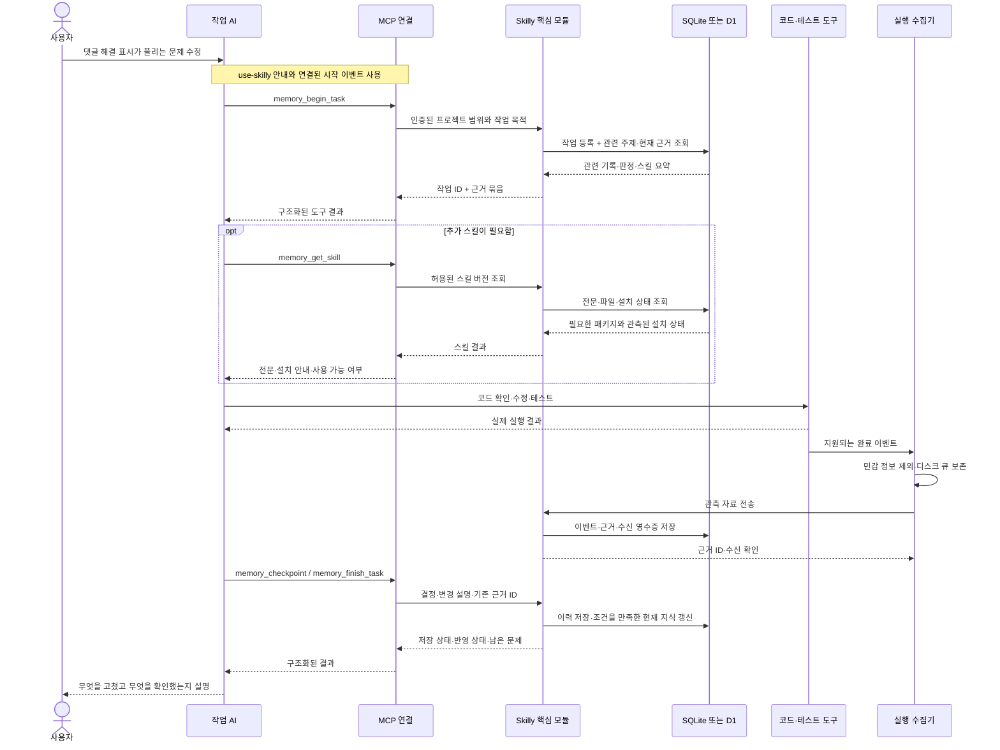

# 한 사이클 따라가기

**사용자 요청 → 관련 기록 조회 → 필요한 스킬 선택 → 실제 작업 → 근거 수집 → 이력 저장 → 다음 작업에 재사용.**

## 현재 로컬에서 사용하는 순서

1. AI가 연결된 `memory_resolve_project`로 프로젝트·저장소·환경을 식별한다.
2. `memory_query_context`로 이전 기록을 찾고 필요하면 현재 지식·계획·스킬을 조회한다.
3. `memory_begin_task`의 저장 응답을 받은 후 허용된 작업을 수행한다.
4. 의미 있는 변경을 `memory_checkpoint`에 저장한다. 지원되는 검사는 명시적
   `skilly exec`로 실행해 프로세스 결과·지원 검사 상세·코드 관측을 별도로 보관한다.
5. 선택적 훅이 신뢰된 환경은 수신한 최소 이벤트를 현재 작업 ID에 명시 연결한다.
   중단 시 `memory_get_status`에서 마지막 저장 지점과 이벤트 연결 상태를 구분한다.
6. `memory_finish_task`로 결과·검사·한계·남은 일을 마감한다. 저장 실패는 보관이
   확인된 원래 요청만 복구하며 서버가 받지 못한 요청까지 복원하지 않는다.
7. 다음 채팅은 같은 프로젝트를 식별하고 기존 보고·실행 결과를 조회한 뒤 현재 코드와
   대조한다. 과거 검사의 성공이나 작업 마감만으로 현재 정상 동작을 판정하지 않는다.

현재 기능·미검증 항목은 [개발·사용 안내](development.md#현재-로컬-기능과-확인-범위),
지원 입력은 [Codex 연동](codex-integration.md), 검사·비교의 한계는
[실행 결과](execution-results.md)를 따른다. Skilly가 모든 명령·대화를 감시하지는 않는다.

## 초기 목표 흐름 예시 (보존)

아래는 2026-10-20의 설계 예시다. 도구 이름·JSON·코드 경로·검증 결과는 목표 흐름을
설명하는 가상 사례이며 현재 실행 결과나 복사해서 호출할 계약이 아니다.
명시적 실행기·훅·현재 지식 조회는 이후 구현됐지만, 예시의 가상 검증 수치·근거 승격·
자동 전달을 모두 구현했다는 뜻은 아니다. 원래 예시는 아래에 보존한다.

## 1. 먼저 등장인물 구분

| 이름 | 무엇인가 | 무엇을 하는가 |
|---|---|---|
| 작업 AI | 사용자가 평소 사용하는 Codex·Cursor | 요청 해석, 실제 개발 도구 사용, 요약·기능 분류, 결과 설명 |
| `use-skilly` | AI가 읽는 스킬 안내서 | 작업 시작·중간·종료에 어떤 기록 도구를 쓸지 안내 |
| MCP 연결 | AI가 호출할 도구를 제공하는 실행 프로그램 | `memory_*` 요청을 Skilly로 전달하고 결과 반환 |
| 실행 훅·수집기 | 허용된 실행 이벤트를 받는 연결 프로그램 | 도구 결과를 정리해 로컬 큐에 보존하고 정본에 전달 |
| 핵심 모듈 | Skilly의 공통 업무 처리 | 프로젝트 식별, 검색, 기록, 코드 규칙에 따른 현재성 판정, 권한 확인 |
| 저장소 Adapter | SQLite 또는 D1 연결 구현 | 핵심 모듈의 저장·조회 계약을 실제 DB에서 수행 |

**스킬 파일 자체가 DB를 읽거나 코드를 실행하는 것은 아니다.** AI가 안내를 따라 실행 가능한 도구를 호출한다. 스킬을 설치하는 것만으로 매 작업 자동 호출을 보장하지 않으므로, 지원되는 훅이나 워크플로 연결이 작업 시작과 실제 실행 결과를 전달한다.

**이 흐름에서 AI는 작업 AI 하나다.** Skilly에는 별도 모델·추론 서버·LLM API 호출이 없다. “현재성 판정”은 전달받은 근거의 출처·범위·소스 버전·대체 여부를 코드로 비교한다는 뜻이다.

`use-skilly`는 처음부터 AI가 발견할 수 있는 설치 위치에 둔다. 이 스킬을 얻으려고 먼저 Skilly DB를 열어야 하는 순환 구조는 만들지 않는다. 다른 개발·검토 스킬의 이름·설명은 DB에서 찾고, 필요한 전문과 설치 상태만 추가 조회한다.

## 2. 한눈에 보는 호출 순서

예시 요청: **“댓글을 해결로 표시했는데 새로고침하면 풀려. 고쳐줘.”**



훅이 이미 작업을 등록하고 시작 컨텍스트를 전달했다면 AI는 같은 작업 ID를 재사용한다. 위 그림의 시작 호출을 중복해서 실행할 필요가 없다. 훅이 지원되지 않는 환경은 워크플로 래퍼를 사용하고, 수집할 수 없는 결과는 미확인으로 남긴다.

## 3. 시작: 요청과 프로젝트를 식별

컴퓨터의 연결 설정은 현재 코드 폴더를 등록된 프로젝트·저장소·worktree에 매핑한다. 이것은 기기별 정보이고 프로젝트의 논리 ID는 폴더 이동 후에도 유지된다.

AI는 `use-skilly` 안내에 따라 다음과 같은 업무 입력을 보낸다.

```json
{
  "project_binding": "binding-review",
  "mode": "change",
  "goal": "새로고침 후 댓글 해결 표시가 풀리는 문제 수정",
  "environment": "development",
  "idempotency_key": "session-17:task-start:1"
}
```

이는 `memory_begin_task`의 입력 예시다. 실제 MCP 전송 형식은 연결 계층이 감싸며, 클라우드 모드에서는 같은 의미의 업무 입력을 버전이 있는 HTTP 계약으로 전달한다.

서버는 `project_binding`이 인증된 사용자에게 허용된 연결인지 확인한다. 사용자·워크스페이스 권한을 JSON에 적힌 주장만으로 결정하지 않는다.

이때의 저장은 다음과 같다.

| 자료 | 기록 위치 |
|---|---|
| 이번 작업 ID·목적·상태 | 정본 DB의 `runs` |
| 시작 이벤트·멱등 키·수신 확인 | 정본 DB의 `events`, `receipts` |
| 내 컴퓨터의 실제 폴더 경로 | 로컬 연결 정보 |

## 4. 검색: 원하는 기능과 기록을 좁힘

검색 모듈은 아래 순서로 찾는다.

1. 현재 프로젝트·저장소·환경·권한 범위를 고정한다.
2. “댓글”, “해결 표시”, “새로고침”을 주제 이름·별칭·본문·코드 연결과 대조한다.
3. `topics`와 구조 색인으로 기능 후보를 좁히고, FTS5로 본문 후보를 보완한다.
4. 해당 기능의 현재 지식, 이전 작업, 필요한 스킬을 모은다.
5. 출처·대체 관계·확인 시점·소스 지문을 확인하고 짧은 근거 묶음을 반환한다.

Skilly 검색은 인덱스와 코드 규칙으로 수행하며 별도 LLM을 호출하지 않는다. 구조 검색으로 해결되지 않는 모호함은 기존 작업 AI가 반환된 후보를 살펴보고 후속 조회한다. `no_match`는 “수집된 범위에서 못 찾음”이며 기능이 없다는 증거가 아니다.

시작 결과의 예:

```json
{
  "schema_version": 1,
  "run_id": "run-104",
  "persistence": "persisted",
  "project_id": "project-review",
  "snapshot_revision": 48,
  "context": {
    "topic_id": "topic-comment-resolution",
    "match_status": "matched",
    "why_matched": ["댓글 해결 상태의 별칭 일치", "관련 코드 연결 일치"],
    "facts": [
      {
        "kind": "product_decision",
        "status": "current",
        "text": "이 예시 프로젝트에서는 본인이 작성한 댓글만 해결 처리한다.",
        "evidence_ids": ["evidence-decision-7"]
      },
      {
        "kind": "verification",
        "status": "stale",
        "text": "이전 버전의 저장 검증이 있으며 현재 소스에는 재확인이 필요하다.",
        "evidence_ids": ["evidence-test-29"]
      }
    ],
    "skill_summaries": [
      {
        "skill_id": "skill-comment-debugging",
        "version": "1.2.0",
        "summary": "댓글 상태의 저장과 재조회 흐름 점검",
        "installation_status": "available"
      }
    ]
  }
}
```

AI는 정책은 참고하되 오래된 테스트를 이번 코드의 성공으로 사용하지 않는다. 원문이 필요하면 `memory_get_evidence`, 다른 질문이 생기면 `memory_query_context`로 필요한 범위만 추가 조회한다.

## 5. 스킬 조회와 실제 작업

예시의 `skill-comment-debugging`은 설명을 위한 가상 스킬이다. AI가 필요하다고 판단한 경우 다음 요청을 한다.

```json
{
  "skill_id": "skill-comment-debugging",
  "version": "1.2.0",
  "scope": ["full_text", "file_manifest", "installation_status"]
}
```

`memory_get_skill`은 해당 버전의 전문, 참조 파일 목록, 설치 방법과 실제 관측된 설치 상태를 반환한다. 큰 참조 파일은 필요한 파일만 후속 조회한다.

스킬 전문의 보존과 자동 실행은 다르다. AI는 현재 요청과 실행 도구의 규칙 안에서 스킬을 적용한다. 카탈로그에 있다는 이유만으로 설치 스크립트를 실행하지 않는다. 관측할 수 없는 설치·실행 상태도 추정하지 않는다.

실제 코드 확인·수정·테스트는 기존 작업 AI와 개발 도구가 수행한다. Skilly는 개발 도구를 대체하는 별도 개발 AI가 아니다.

## 6. 두 경로로 기록을 받음

### A. 실제 실행 결과

수집기는 허용된 완료 이벤트에서 명령, 종료 상태, 대상 소스 지문, 관측 시각, 비민감 결과를 추출한다. 먼저 로컬 큐에 보존하고 정본에 전송한다.

정본의 관측 수신 Interface는 AI용 `memory_checkpoint`와 구분한다. 수신 자료가 신뢰할 수 있는 실행 경로에서 왔는지 확인하고, DB가 이벤트와 근거를 확정한 뒤 수신 영수증을 돌려준다.

근거 ID는 도구 응답 보강 또는 작업 상태 조회로 AI가 참조할 수 있게 연결한다. 해당 실행 환경에서 이런 연결이 불가능하면 AI가 ID를 만들어내지 않고 관측 제한을 표시한다.

### B. AI가 정리한 결정과 변경 설명

AI는 `memory_checkpoint`에 작업 설명과 기존 근거 ID를 보낸다.

```json
{
  "run_id": "run-104",
  "idempotency_key": "run-104:checkpoint:2",
  "summary": "댓글 해결 상태의 저장과 재조회 처리 수정",
  "evidence_ids": ["evidence-tool-53"],
  "unverified": ["운영 배포 후 동작"]
}
```

AI가 `verified: true`를 적는 것만으로 검증을 확정하지 않는다. 기록 모듈은 설명을 보존하고, 현재 지식 모듈은 구조화된 실행 결과와 주장 사이의 출처·대상·소스 버전·완료 상태를 검사한다. 자연어 설명 전체가 참인지 추론하지 않으며, 그 범위를 넘는 주장은 미확인으로 남긴다.

| 내용 | 정본 DB의 논리 위치 |
|---|---|
| 실제 실행 이벤트·수신 확인 | `events`, `receipts` |
| 변경 설명·결정·전사문 등의 원문 | `records`, `record_versions` |
| 주제·코드·작업의 연결 | `topics`, `record_topics`, `run_topics`, `topic_code_links` |
| 근거와 판정 이력 | `evidence_links`, `knowledge_revisions`, `knowledge_events` |
| 지금 적용할 지식의 포인터 | `current_heads` |
| 검색용 파생 자료 | `search_documents`, FTS5 색인 |
| 적용한 스킬·버전·실제 설치 관측 | 스킬 버전·설치·작업 연결 자료 |

물리 테이블 수와 세부 컬럼은 구현 단계에서 확정한다. 본문을 저장한 것, 검색 색인에 반영한 것, 현재 지식으로 판정한 것은 서로 다른 상태다.

## 7. 종료: 도구 결과와 사용자 답변

AI는 실제 변경 결과, 검증 범위, 미검증 범위를 `memory_finish_task`로 전달한다. 종료 훅은 중단·종료 관측을 보완하며, 종료됐다는 이유만으로 성공을 확정하지 않는다.

도구 결과의 예:

```json
{
  "schema_version": 1,
  "run_id": "run-104",
  "persistence": "persisted",
  "knowledge_state": "evaluated",
  "record_id": "record-208",
  "snapshot_revision": 49,
  "remaining": ["운영 배포 및 운영 확인은 수행하지 않음"]
}
```

AI는 이 JSON을 그대로 사용자에게 붙이지 않고 원래 작업 결과를 설명한다. 이 가상 사례에서 실제 수정과 테스트 근거가 확인됐다면 답변은 “해결 상태를 저장·재조회하는 처리를 수정했고 관련 테스트를 확인했습니다. 운영 배포는 하지 않았습니다.”처럼 된다.

Skilly가 만드는 것은 근거와 저장 상태가 있는 도구 결과다. 사람이 읽는 최종 답변은 작업 AI가 만든다. 저장이 실패했다면 작업의 성공과 기록의 실패를 구분해 알려야 한다.

## 8. 다음 작업에서 무엇이 달라지는가

다음 세션은 같은 프로젝트·주제를 찾고 개정 번호 49의 지식과 근거부터 조회한다. 과거 기록도 남아 있지만, 현재 상태에 적용 가능한 근거를 우선 사용한다.

그 사이 코드가 바뀌거나 정책이 대체됐다면 과거 테스트는 다시 `stale`이 될 수 있다. 마지막에 저장했다는 이유만으로 계속 최신 사실이 되는 것은 아니다.

## 9. 로컬과 클라우드에서 바뀌는 구간

```text
로컬:
AI → MCP → 로컬 Skilly 핵심 모듈 → SQLite

클라우드:
AI → 로컬 MCP 연결 → 인증된 HTTP 요청
   → Cloudflare의 Skilly 핵심 모듈 → D1
```

스킬 안내, 업무 입력, 결과 의미, 현재성 규칙은 같다. 저장소 연결과 실행 환경만 다르다. DB를 다른 곳으로 옮길 때는 [이전 절차](architecture.md#6-데이터-이전과-호환성)로 자료를 검증한 뒤 프로젝트의 정본 연결을 전환한다.

음성은 나중에 “로컬 녹음 → 로컬 변환기 → 전사 결과 가져오기”가 새로운 입력 경로로 들어온다. 기존 원문·이력·근거 판정 흐름을 재사용한다.

## 10. 정상 흐름 밖에서 반환할 상태

| 상황 | 처리 |
|---|---|
| 클라우드 연결 실패 | 디스크 큐에 보존됐다면 `queued`; 중앙 저장 완료로 표시하지 않음 |
| 권한 없음·잘못된 입력 | `rejected`; 다른 프로젝트로 범위를 넓히지 않음 |
| 같은 이벤트 재전송 | 같은 영수증으로 처리하고 중복 기록하지 않음 |
| 현재성·권한 변경 | 영향을 받는 근거를 재조회 |
| 서로 충돌하는 결정 | `conflict`; 도착 순서만으로 덮어쓰지 않음 |
| 수집되지 않은 실행 결과 | `unknown` 또는 수집 누락; AI가 성공 근거를 만들어내지 않음 |
| 검색 색인 반영 대기 | 검색 범위가 불완전함을 표시; 검색 실패를 기록 부재로 단정하지 않음 |
| 사용자가 기록 중단 | 이후 수집과 기존 대기 기록의 전송을 중단 정책에 맞춰 멈춤 |

정상 저장은 사용자를 반복해서 방해하지 않는다. 중요한 기록 실패나 현재 답변을 바꾸는 충돌만 대화에 드러낸다.

## 11. 이 사이클에서 자원을 쓰는 시점

```text
작업 시작       Skilly가 해당 프로젝트의 짧은 근거 묶음을 조회
AI가 코드 작업  Skilly는 입력 대기; 코드 분석·테스트는 기존 AI와 개발 도구가 실행
실행 결과 도착  허용된 결과만 저장하고 변경된 기록의 인덱스 갱신
작업 마감       기존 AI가 작성한 요약·근거 참조 저장
세션 종료       연결·프로세스 정리; 미전송 기록은 디스크에서 다음 연결까지 대기
```

AI 세션이 열려 있으면 MCP 프로세스의 메모리는 남을 수 있다. 다만 작업이 없는 동안 전체 기록 재분석, 폴더 반복 스캔, 자체 AI 호출을 실행하지 않는다. 처음부터 별도 상주 서버나 대량 처리 워커를 운영하지 않는다.

일반 컨텍스트 조회는 기본 10건과 전체 JSON 32 KiB 안에서 제공하고, 필요하면 원문·스킬 전문을 나눠 추가 조회한다. 기존 MD 일괄 가져오기·큰 내보내기는 후속 유지보수 작업이며 일상적인 개발 사이클의 필수 단계가 아니다. 구체적인 상한과 아직 측정하지 않은 성능 목표는 [저자원 실행 기준](architecture.md#7-빠르고-가볍게-만드는-기준)에 있다.
